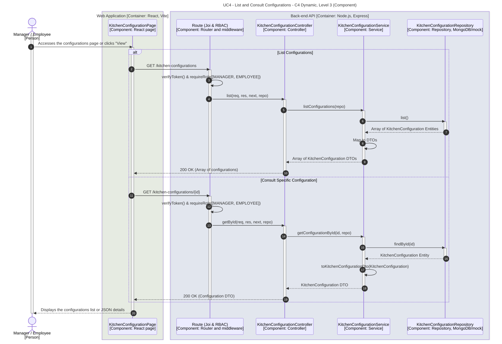

# UC4 - List and Consult Configurations

| Attribute | Value |
|---|---|
| C4 view | Dynamic diagram, Level 3 (Component) |
| SAD view | Process View, Level 3 |
| Containers | Web Application, Back-end API, Database |
| Endpoints | `GET /kitchen-configurations`, `GET /kitchen-configurations/{id}` |
| Allowed roles | MANAGER, EMPLOYEE |
| Success response | 200 OK |
| Error handling | 400 (invalid id format), 401/403 (no valid token or role not allowed), 404 (not found) |
| ADRs | [ADR-0025](../../adr/0025-active-configuration-endpoint-and-no-fallback-policy.md) |

## Description

Managers and Employees can retrieve the list of stored kitchen configurations, which includes their activation status, and consult the full JSON content of a specific configuration. The Web Application hides the Create, Edit, Activate, and Delete controls for users with the Employee role, providing a read-only view.

## Diagram

