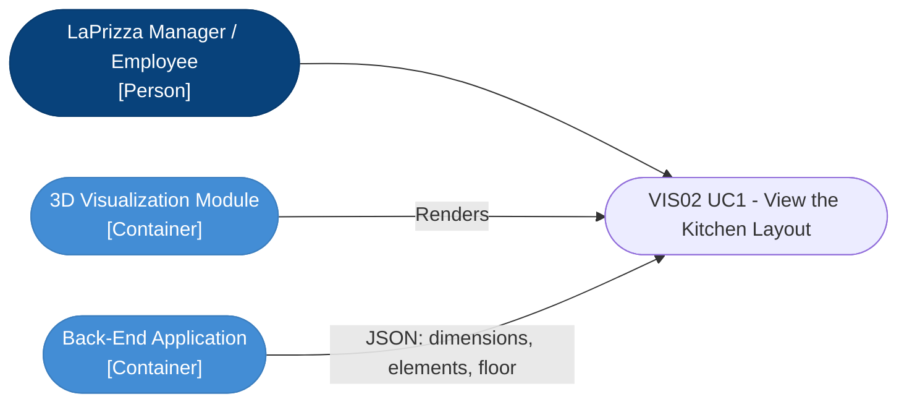

# Kitchen Layout and Equipment - Design Diagrams (Mermaid)

The kitchen layout (VIS02) is drawn by the **3D Visualization** module embedded in the **Web Application**, from the active kitchen configuration read from the back end as JSON ([WEB06 UC3](../kitchen-configuration/get-active-kitchen-configuration.md)): the floor with the kitchen dimensions, the four walls, and every equipment, furniture and tool element at its position, orientation and scale. No layout is embedded in the SPA, and when no configuration is active nothing is drawn in its place ([ADR-0025](../../adr/0025-active-configuration-endpoint-and-no-fallback-policy.md)). The assembly line placed in the kitchen is VIS03 ([Assembly Line](../assembly-line/README.md)), the textures and materials are VIS04 ([Textures and Materials](../textures-and-materials/README.md)) and the lighting is VIS05 ([Scene Lighting](../scene-lighting/README.md)).

Process View (SAD), Level 3, documented as a C4 dynamic diagram of the **Web Application**, **3D Visualization** and **Back-end API** containers.

## Use Cases

The use case is described in the [Use Case Views](../../analysis/use-case-views.md#vis02-kitchen-layout-and-equipment).

## Diagrams

| Use case | Endpoint | Pages | Result | Document |
|---|---|---|---|---|
| [VIS02 UC1 - View the Kitchen Layout](./view-kitchen-layout.md) | `GET /kitchen-configurations/active` | `/visualization3d`, `/kitchen-configurations` | The kitchen of the active configuration in 3D: floor, walls and elements | `view-kitchen-layout.md` |

| Method and path | Permission | Success | Errors |
|---|---|---|---|
| `GET /kitchen-configurations/active` | `kitchen:read` | 200, `{ id, name, content, isActive }` | 401, 403, 404 (no active configuration) |

Paths under `/api/v2`. `kitchen:read` is granted to the Manager and the Employee. Creating, editing, validating and activating configurations is WEB06 ([Kitchen Configuration](../kitchen-configuration/README.md)).

## Kitchen layout in the configuration

The layout is the `content` of the kitchen configuration ([JSON Format](../kitchen-configuration/kitchen-configuration-json-format.md)). The properties read by VIS02:

| Property | Rule (back end) | Drawn as |
|---|---|---|
| `dimensions.width`, `length`, `height` | Required, greater than 0 (metres) | Floor plane `width × length`; four walls `height` high |
| `floor.material` | Required, textured (VIS04) | Floor texture, one repetition every 1.5 m when the JSON has no colour map |
| `elements[].id` | Required, unique | Name of the 3D group of the element (furniture models) |
| `elements[].type` | `equipment`, `assembly-line`, `decoration` or `tool` | Chooses the model (table below) |
| `elements[].model` | Optional: `work-table`, `fridge`, `shelves`, `cabinet`, `ingredient-bins`, `dough-trays` (meant for `decoration` and `tool` elements) | Procedural furniture built at its real size |
| `elements[].position` | Inside the kitchen: x in `[-width/2, width/2]`, z in `[-length/2, length/2]`, y in `[0, height]` (origin at the centre of the floor, y up) | Position of the base of the element, metres |
| `elements[].rotation` | Required | Degrees, converted to radians |
| `elements[].scale` | Each axis greater than 0 and not larger than the kitchen (x ≤ width, y ≤ height, z ≤ length) | Size of the element in metres (models are built at unit size) |
| `elements[].material` | Required, textured (VIS04) | Material of the whole element |
| `elements[].modelReference` | Optional URL of an imported model ([ADR-0021](../../adr/0021-asset-references-strategy.md)) | Validated and stored, not drawn yet (see Notes) |

### Models by element

| Element | Model (`kitchen-scene.jsx`, `kitchen-models.jsx`) | Size |
|---|---|---|
| Any element with `model: "work-table"` | Steel work table: top, four legs and a lower shelf | Built at `scale` (metres), not stretched |
| `model: "fridge"` | Upright fridge: body, two doors on the front (+z) with vertical handles | As above |
| `model: "shelves"` | Open shelving unit: sides, back and evenly spaced boards with containers | As above |
| `model: "cabinet"` | Base cabinet: plinth, body, overhanging top and doors with handles on the front (+z) | As above |
| `model: "ingredient-bins"` | Row of open ingredient bins, each filled below the rim | As above |
| `model: "dough-trays"` | Stack of trays with dough balls on the top tray | As above |
| `equipment` without `model` | Stone/dome wood-fired oven: stone base and a half-sphere dome | Unit model scaled by `scale` |
| `assembly-line` without `model` (generic type kept for compatibility) | Metal frame with a dark belt | Unit model scaled by `scale` |
| `decoration` or `tool` without `model` | Box | Unit box scaled by `scale` |

The `model` is checked before the type, so an element with a `model` is always drawn as that furniture. Furniture models stand on y = 0 of their origin with the front towards +z; `rotation.y` turns the front towards the room. Every element is an obstacle for the camera (VIS07) and casts and receives shadows (VIS05).

## Business rules shown in the diagrams

- **Everything from the back end as JSON.** Dimensions, positions, orientations, scales, furniture models and materials come from the active configuration; the SPA embeds no layout.
- **The active configuration only.** The viewer draws the configuration activated in WEB06. Without an active configuration (404) it shows "No active kitchen configuration to display." and no scene, never a default layout ([ADR-0025](../../adr/0025-active-configuration-endpoint-and-no-fallback-policy.md)).
- **Inside the kitchen.** The back end rejects positions outside the kitchen and sizes larger than it, so every element is drawn inside the walls ([ADR-0052](../../adr/0052-ui-consistency-and-input-validation-after-the-sprint-2-review.md) D7).
- **Real sizes.** A scale is a size in metres; furniture is built at that size, so legs, handles and boards keep their thickness.
- **Reload after activation.** After a new configuration is activated, the viewer is remounted and reads the active configuration again ([ADR-0027](../../adr/0027-viewer-reload-mechanism-in-the-frontend.md)).

## Related ADRs

| ADR | Decision | Status |
|---|---|---|
| [ADR-0020](../../adr/0020-strorage-model-of-kitchen-configurations.md) | Storage model of kitchen configurations | Accepted |
| [ADR-0021](../../adr/0021-asset-references-strategy.md) | Asset references strategy (URLs and root-relative paths) | Accepted |
| [ADR-0022](../../adr/0022-content-validation-strategy.md) | Content validation strategy (JSON Schema and domain rules) | Accepted |
| [ADR-0025](../../adr/0025-active-configuration-endpoint-and-no-fallback-policy.md) | Active configuration endpoint and no fallback policy | Accepted |
| [ADR-0027](../../adr/0027-viewer-reload-mechanism-in-the-frontend.md) | Viewer reload mechanism in the frontend | Accepted |
| [ADR-0030](../../adr/0030-adoption-of-r3f-for-3d-module-integration.md) | React Three Fiber for the 3D module | Accepted |
| [ADR-0052](../../adr/0052-ui-consistency-and-input-validation-after-the-sprint-2-review.md) | UI consistency and input validation (D7: positions and sizes inside the kitchen) | Accepted |

## Notation key

| Notation | Meaning |
|---|---|
| Actor (stick figure) | Person using the system, with the role shown in the label |
| Shaded box "Web Application" | Container (React, Vite) that holds the page components |
| Shaded box "3D Visualization" | Container (WebGL, Three.js) that holds the viewer and the scene |
| Shaded box "Back-end API" | Container (Node.js, Express) that holds the back-end components |
| Participant label | `Name`, followed by `[Type: technology]` |
| Solid arrow | Call or request |
| Dashed arrow | Return value or response |
| Arrow to the same participant | Work done inside that component |
| Number on an arrow | Order of the interaction (autonumber) |
| `alt` / `else` frame | Alternative flows, only one of them runs |
| `loop` frame | Flow that repeats |
| `Note` | Reference to another diagram or a remark |

## Element catalogue

| Element | Type | Technology | Responsibility | Used in |
|---|---|---|---|---|
| Manager / Employee | Person | - | Users with `kitchen:read` | [VIS02 UC1](./view-kitchen-layout.md) |
| Visualization3dPage / KitchenConfigurationPage | Component | React pages | Render `KitchenViewer` inside the SPA layout | [VIS02 UC1](./view-kitchen-layout.md) |
| KitchenViewer | Component | React component (`kitchen-viewer.jsx`) | Loads the active configuration, shows the loading, empty and warning states and the name of the configuration, renders `KitchenScene` | [VIS02 UC1](./view-kitchen-layout.md) |
| useKitchenConfiguration | Component | React hook | `loadActive` (`GET /kitchen-configurations/active`), then the assembly line (VIS03) | [VIS02 UC1](./view-kitchen-layout.md) |
| KitchenScene | Component | React Three Fiber `Canvas` (`kitchen-scene.jsx`) | Camera from the kitchen size, floor, walls, `SceneElement` per element, lighting (VIS05/VIS06), camera controls (VIS07) | [VIS02 UC1](./view-kitchen-layout.md) |
| SceneElement / SceneElementModel | Component | R3F groups and meshes | Material of the element (VIS04), position, rotation (degrees), scale, and the model of its type or `model` | [VIS02 UC1](./view-kitchen-layout.md) |
| Kitchen models | Component | R3F meshes (`kitchen-models.jsx`) | `WorkTableModel`, `FridgeModel`, `ShelvesModel`, `CabinetModel`, `IngredientBinsModel`, `DoughTraysModel` (`KITCHEN_MODELS`) | [VIS02 UC1](./view-kitchen-layout.md) |
| Route (Joi & Permissions) | Component | Express router and middleware | `requirePermission(kitchen:read)` | [VIS02 UC1](./view-kitchen-layout.md) |
| KitchenConfigurationController / Service | Component | Express controller, Node.js module | `getActive`, `getActiveConfiguration` (404 without an active configuration), `toKitchenConfigurationDto` | [VIS02 UC1](./view-kitchen-layout.md) |
| KitchenConfigurationRepository | Component | Repository, MongoDB | `getActive` | [VIS02 UC1](./view-kitchen-layout.md) |

## Notes

- **Imported models are not drawn yet.** `modelReference` is validated and stored, but the viewer always draws the procedural model of the element (the `Model` component with `useGLTF` in `kitchen-scene.jsx` is not used). VIS02 allows procedural models.
- **Equipment coverage.** Procedural models exist for the wood-fired oven (`equipment`) and for six kinds of furniture (`model`). Deep fryer, griddle, grill, dishwasher, exhaust hood and cooking tools have no model of their own and are drawn as boxes of their size and material.
- The viewer is shown to every user with `kitchen:read` (Manager and Employee); the user story names the Manager.
- Tests:
  - Back end: `test/domain/kitchen-configuration.domain.test.js` (schema, unique ids, textures, positions and sizes inside the kitchen), fixtures `test/domain/fixtures/kitchen-configurations/*.json`; `test/api/kitchen-configuration.controller.test.js`; httpyac `backend/test-flows/kitchen-configuration-test-flow.http`.
  - Front end: `test/features/visualization3d-scene.test.js` (textures of elements, furniture models and floor, four walls as high as the kitchen, camera obstacles); `test/e2e/kitchen-configuration.spec.js`.
  - The rendering of the models is validated manually in the viewer.
