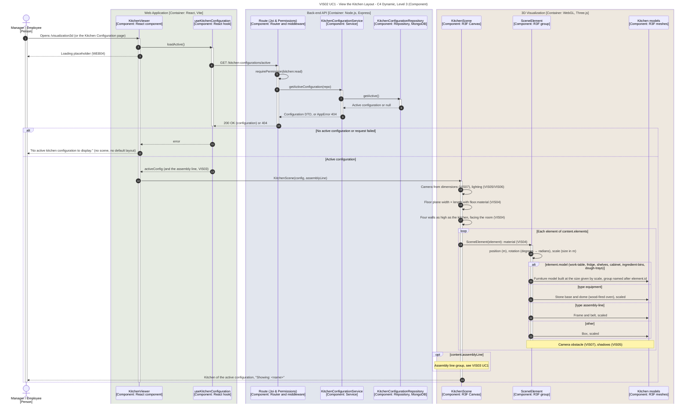

# VIS02 UC1 - View the Kitchen Layout

| Attribute | Value |
|---|---|
| C4 view | Dynamic diagram, Level 3 (Component) |
| SAD view | Process View, Level 3 |
| Containers | Web Application, 3D Visualization, Back-end API, Database |
| Endpoints | `GET /kitchen-configurations/active` ([WEB06 UC3](../kitchen-configuration/get-active-kitchen-configuration.md)) |
| Allowed roles | Users with the `kitchen:read` permission (MANAGER, EMPLOYEE), required by the `/visualization3d` and `/kitchen-configurations` routes and by the endpoint |
| Success response | 200 OK, `{ id, name, content: { dimensions, floor, elements[], assemblyLine? }, isActive: true }`; the kitchen is drawn and its name is shown ("Showing: …") |
| Error handling | No active configuration (404) or the request fails: "No active kitchen configuration to display." and no scene; no other layout is drawn in its place ([ADR-0030](../../adr/0030-active-configuration-endpoint-and-no-fallback-policy.md)). An element without `position`, `rotation` or `scale` is skipped (the back end never stores one) |
| ADRs | [ADR-0030](../../adr/0030-active-configuration-endpoint-and-no-fallback-policy.md), [ADR-0025](../../adr/0025-strorage-model-of-kitchen-configurations.md), [ADR-0039](../../adr/0039-adoption-of-r3f-for-3d-module-integration.md), [ADR-0055](../../adr/0055-ui-consistency-and-input-validation-after-the-sprint-2-review.md) |

## Description

The Manager (or an Employee) opens the 3D Visualization page or the Kitchen Configuration page, which both render `KitchenViewer`.

1. `useKitchenConfiguration().loadActive()` reads the active kitchen configuration ([WEB06 UC3](../kitchen-configuration/get-active-kitchen-configuration.md)). The back end checks `kitchen:read` and returns the configuration marked active, or 404. While it loads, the viewer shows the loading placeholder (WEB04).
2. Without an active configuration the viewer shows "No active kitchen configuration to display." and draws nothing.
3. With a configuration, `KitchenScene` computes the camera from the kitchen size (VIS07) and draws:
   - the **floor**, a plane of `width × length` centred at the origin, with the floor material of the JSON (VIS04);
   - the **walls**, four textured planes as high as the kitchen, facing the room, so the camera can look at the kitchen from outside;
   - each **element** of `content.elements` as a `SceneElement`: its material (VIS04), its position (metres, origin at the centre of the floor), its rotation (degrees, converted to radians) and its scale (its size in metres). `SceneElementModel` chooses the model: the furniture of `model` (work table, fridge, shelves, cabinet, ingredient bins, dough trays, built at their real size), the stone/dome wood-fired oven for `equipment`, a frame with a belt for the generic `assembly-line` type, and a box for any other element;
   - the assembly line of `content.assemblyLine` (VIS03, [View the Automated Assembly Line](../assembly-line/view-assembly-line.md)).
4. Every element is a camera obstacle (VIS07) and casts and receives shadows under the scene lighting (VIS05). The viewer shows the name of the configuration above the scene.

Every element is drawn inside the kitchen, because the back end rejects positions outside it and sizes larger than it when the configuration is saved (WEB06, [ADR-0055](../../adr/0055-ui-consistency-and-input-validation-after-the-sprint-2-review.md) D7). After another configuration is activated, the viewer is remounted and the flow starts again ([ADR-0032](../../adr/0032-viewer-reload-mechanism-in-the-frontend.md)).

## Diagram

See the [README](./README.md) for the layout properties, the models, the notation key and the element catalogue.
