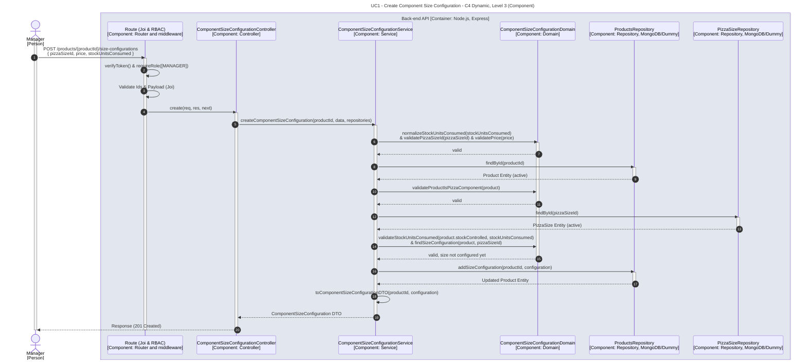

# UC1 - Create Component Size Configuration

| Attribute | Value |
|---|---|
| C4 view | Dynamic diagram, Level 3 (Component) |
| SAD view | Process View, Level 3 |
| Container | Back-end API |
| Endpoint | `POST /products/{productId}/size-configurations` |
| Allowed roles | MANAGER |
| Success response | 201 Created |
| Error handling | Happy path only |

## Description

A Manager adds a size configuration (price and stock units consumed) to a product that is a pizza component. The service validates the input, checks that the product and the pizza size exist and are active, makes sure the size is not configured yet and persists the configuration in the product.

## Diagram

See the [README](./README.md) for the notation key and the element catalogue.
