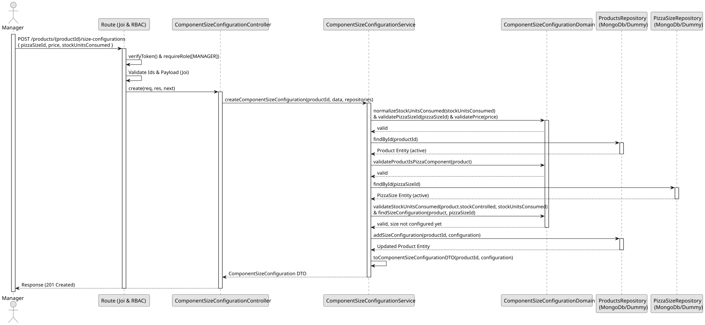

# UC1 - Create Component Size Configuration

## Use Case View

**Primary Actor:** Manager  
**Description:** Allows a manager to create a new Component Size Configuration, associating a pizza component product with a pizza size, and defining its price and stock units consumed.

**Preconditions:**

- The user must be authenticated and have the `MANAGER` role.
- The product must be active and designated as a Pizza Component.
- The pizza size must exist and be active.

**Main Success Scenario:**

1. The Manager provides a payload with the pizza size ID, price, and stock units consumed.
2. The System validates that the price is a number greater than or equal to 0.
3. The System validates the stock units consumed based on the product's stock control settings.
4. The System verifies the product is an active pizza component and the pizza size is active.
5. The System ensures no configuration already exists for this pizza size on the given product.
6. The System saves the new configuration.
7. The System returns the new configuration details with a 201 Created status.

**Alternative Flows:**

- _Missing/invalid fields, invalid IDs, or invalid stock units:_ The System returns a 400 Bad Request error.
- _Request by unauthorized user (`EMPLOYEE` or no token):_ The System returns a 401 Unauthorized or 403 Forbidden error.
- _Product or pizza size not found/inactive:_ The System returns a 404 Not Found error.
- _Pizza size already configured for the product:_ The System returns a 409 Conflict error.

**Postconditions:**

- The Component Size Configuration is saved and linked to the product.

## 1. Domain Assumptions

- Only products designated as Pizza Components can have Component Size Configurations;
- A Component Size Configuration associates a Pizza Component with a Pizza Size and defines the price applicable to the component when used in a pizza of that size;
- For a given Pizza Component and Pizza Size, at most one configuration may exist;
- The price must be a number greater than or equal to 0;
- A stock controlled component must define the number of abstract stock units consumed;
- The product must be active and the pizza size must exist and be active;
- A product or a pizza size that has configurations cannot be deactivated;
- Only users with the `MANAGER` role are authorized to create a Component Size Configuration.

## 2. Solution Design

## 3. Business Test Planning

- **Isolation Strategy:** All application tests use dependency injection via isolated in-memory dummies (`products.dummy.repository.js` and `pizza-size.dummy.repository.js`), avoiding Mocking libraries entirely.
- **Domain Tests (`component-size-configuration.domain.test.js`):**
  - `isPizzaComponent is true when the product has a pizza component type`
  - `isPizzaComponent is true when the pizza component type is a populated document`
  - `isPizzaComponent is false when the product has no pizza component type`
  - `isPizzaComponent is false when there is no product`
  - `validateProductIsPizzaComponent rejects products that are not pizza components`
  - `validateProductIsPizzaComponent accepts pizza components`
  - `normalizeStockUnitsConsumed turns an omitted value into null (not defined)`
  - `normalizeStockUnitsConsumed keeps null and any other value unchanged`
  - `validatePizzaSizeId rejects missing, blank and non-string values`
  - `validatePizzaSizeId accepts non-blank strings`
  - `validatePrice rejects negatives, non-finite values and non-numbers`
  - `validatePrice accepts zero, integers and decimals`
  - `validateStockUnitsConsumed requires stock controlled products to define it`
  - `validateStockUnitsConsumed rejects stock units that are not integers greater than or equal to 1`
  - `validateStockUnitsConsumed accepts integers greater than or equal to 1 for stock controlled products`
  - `validateStockUnitsConsumed does not allow products without stock control to define it`
  - `validateStockUnitsConsumed accepts null for products without stock control`
  - `the domain rules throw DomainError`
- **Application Tests (`component-size-configuration.service.tests.js`):**
  - `toComponentSizeConfigurationDTO exposes the product and the pizza size as strings`
  - `toComponentSizeConfigurationDTO turns missing stock units into null`
  - `createComponentSizeConfiguration saves the configuration of a stock controlled component`
  - `createComponentSizeConfiguration saves a component without stock control without stock units`
  - `createComponentSizeConfiguration accepts a price of zero`
  - `createComponentSizeConfiguration allows several sizes for the same component and the same size for several components`
  - `createComponentSizeConfiguration rejects invalid data without saving`
  - `createComponentSizeConfiguration requires stock units for stock controlled components`
  - `createComponentSizeConfiguration does not accept stock units for components without stock control`
  - `createComponentSizeConfiguration rejects products that are not pizza components`
  - `createComponentSizeConfiguration throws 404 if the product does not exist or is inactive`
  - `createComponentSizeConfiguration throws 404 if the pizza size does not exist or is inactive`
  - `createComponentSizeConfiguration returns 409 Conflict if the size is already configured`
  - `createComponentSizeConfiguration returns 409 Conflict if another request configured the size in the meantime`
  - `createComponentSizeConfiguration validates the data before looking for the product`
  - `createComponentSizeConfiguration checks the product is a pizza component before looking for the pizza size`

## 4.E2E Tests

- **Base Endpoint:** `POST /api/v1/products/{productId}/size-configurations`
- **Validated Scenarios:**
  - Request without Bearer Token -> `401 Unauthorized`
  - Request with `EMPLOYEE` Bearer Token -> `403 Forbidden` (RBAC Enforcement)
  - Valid payload by `MANAGER` -> `201 Created`
  - Invalid ids, missing or invalid fields, product that is not a pizza component, or stock units that do not respect the product's stock control -> `400 Bad Request`
  - Unknown product or pizza size -> `404 Not Found`
  - Pizza size already configured for the product -> `409 Conflict`
