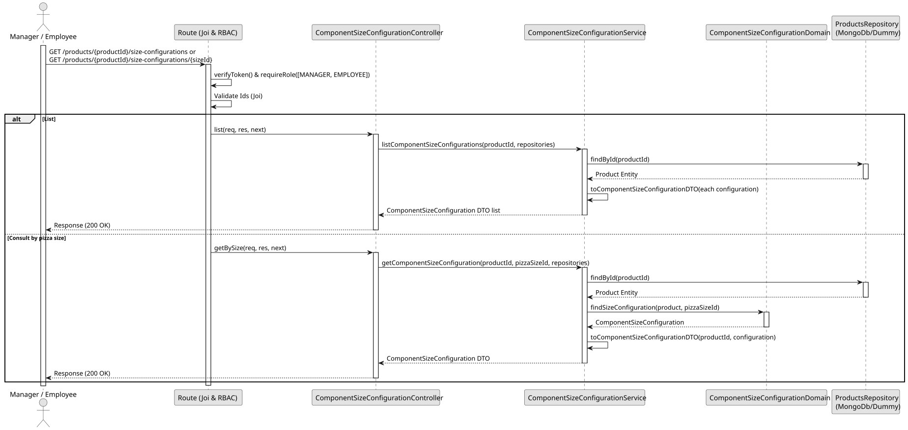

# UC2 - List / Search Component Size Configuration

## Use Case View

**Primary Actor:** Manager / Employee  
**Description:** Allows a manager or employee to list all size configurations for a specific pizza component, or consult a specific configuration by its pizza size ID.

**Preconditions:**

- The user must be authenticated and have the `MANAGER` or `EMPLOYEE` role.

**Main Success Scenario:**

1. The user requests the configurations for a specific product ID, optionally providing a pizza size ID.
2. The System validates the provided IDs.
3. The System retrieves the product and finds its configurations (even if the product is inactive).
4. The System maps the data to DTOs and returns the list or the specific configuration with a 200 OK status.

**Alternative Flows:**

- _Product has no configurations:_ The System returns an empty list `[]` (200 OK).
- _Invalid product or pizza size ID format:_ The System returns a 400 Bad Request error.
- _Unauthorized request:_ The System returns a 401 Unauthorized error.
- _Unknown product or unconfigured pizza size:_ The System returns a 404 Not Found error.

**Postconditions:**

- None (Read-only operation).

## 1. Domain Assumptions

- The size-dependent configurations of a Pizza Component are consulted through the product that owns them;
- A product without configurations returns an empty list;
- A configuration is consulted by the product and the pizza size that identify it;
- The configurations of an inactive product can still be consulted;
- Users with `MANAGER` and `EMPLOYEE` role are authorized to list and search Component Size Configurations.

## 2. Solution Design

## 3. Business Test Planning

- **Isolation Strategy:** All application tests use dependency injection via isolated in-memory dummies (`products.dummy.repository.js`), avoiding Mocking libraries entirely.
- **Domain Tests (`component-size-configuration.domain.tests.js`):**
  - `findSizeConfiguration returns the configuration of the given pizza size`
  - `findSizeConfiguration compares ids as strings (ObjectId-like values)`
  - `findSizeConfiguration returns null when there is no configuration for the pizza size`
  - `findSizeConfiguration returns null when the product has no configurations`
- **Application Tests (`component-size-configuration.service.tests.js`):**
  - `listComponentSizeConfigurations returns the configurations of the product`
  - `listComponentSizeConfigurations returns an empty list for a product without configurations`
  - `listComponentSizeConfigurations also works for an inactive product`
  - `listComponentSizeConfigurations throws 404 if the product does not exist`
  - `getComponentSizeConfiguration returns the configuration of the pizza size`
  - `getComponentSizeConfiguration also works for an inactive product`
  - `getComponentSizeConfiguration throws 404 if the product or the configuration does not exist`

## 4.E2E Tests

- **Base Endpoint:** `GET /api/v1/products/{productId}/size-configurations`
- **Validated Scenarios:**
  - Request without Bearer Token -> `401 Unauthorized`
  - List by `MANAGER` or `EMPLOYEE` -> `200 OK`
  - Product without configuration -> `200 OK` with `[]`
  - Get by pizza size (`GET /api/v1/products/{productId}/size-configurations/{sizeId}`) -> `200 OK`
  - Unknown product or unconfigured pizza size -> `404 Not Found`
  - Invalid product or pizza size id -> `400 Bad Request`
