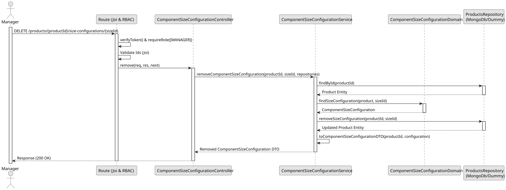

# UC4 - Remove Component Size Configuration

## 1. Domain Assumptions

- After the removal, the pizza size is free to be configured again for the product;
- A product that has Component Size Configurations cannot be deactivated, and neither can a pizza size that is used in the configurations of any product;
- Only users with the `MANAGER` role are authorized to remove a Component Size Configuration.

## 2. Solution Design

## 3. Business Test Planning

- **Isolation Strategy:** All application tests use dependency injection via isolated in-memory dummies (`products.dummy.repository.js` and `pizza-size.dummy.repository.js`), avoiding Mocking libraries entirely.
- **Application Tests (`component-size-configuration.service.tests.js`):**
  - `removeComponentSizeConfiguration removes the configuration and returns it`
  - `removeComponentSizeConfiguration also works for an inactive product`
  - `removeComponentSizeConfiguration throws 404 if the product or the configuration does not exist`
  - `removeComponentSizeConfiguration throws 404 if the configuration was already removed`
  - `removeComponentSizeConfiguration throws 404 if the configuration disappeared in the meantime`
  - `removing a configuration frees the pizza size to be configured again`

## 4.E2E Tests

- **Base Endpoint:** `DELETE /api/v1/products/{productId}/size-configurations/{sizeId}`
- **Validated Scenarios:**
  - Request without Bearer Token -> `401 Unauthorized`
  - Request with `EMPLOYEE` Bearer Token -> `403 Forbidden` (RBAC Enforcement)
  - Valid payload by `MANAGER` -> `200 OK`
  - Invalid ids -> `400 Bad Request`
  - Unknown product or unconfigured pizza size -> `404 Not Found`
