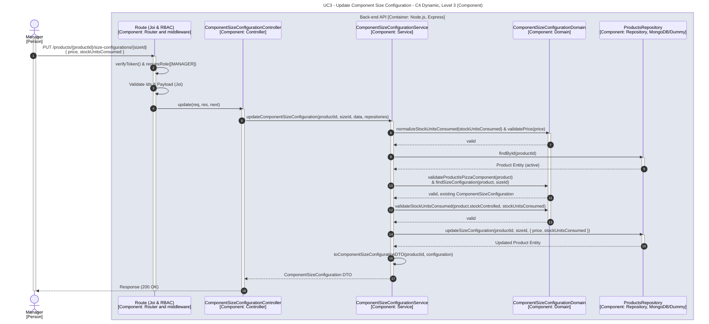

# UC3 - Update Component Size Configuration

| Attribute | Value |
|---|---|
| C4 view | Dynamic diagram, Level 3 (Component) |
| SAD view | Process View, Level 3 |
| Container | Back-end API |
| Endpoint | `PUT /products/{productId}/size-configurations/{sizeId}` |
| Allowed roles | MANAGER |
| Success response | 200 OK |
| Error handling | Happy path only |

## Description

A Manager updates the price and the stock units consumed of an existing size configuration of a product component.

## Diagram

See the [README](./README.md) for the notation key and the element catalogue.
