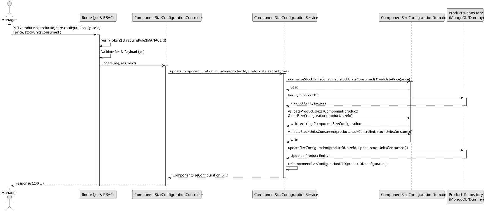

# UC3 - Update Component Size Configuration

## 1. Domain Assumptions

- The update replaces the price and the number of stock units consumed of an existing configuration;
- The pizza size cannot be changed;
- The new values follow the same rules as in the creation;
- The product must be a Pizza Component;
- Only users with the `Manager` role are authorized to update a Component Size Configuration.

## 2. Solution Design

## 3. Business Test Planning

- **Isolation Strategy:** All application tests use dependency injection via isolated in-memory dummies (`products.dummy.repository.js`), avoiding Mocking libraries entirely.
- **Application Tests (`component-size-configuration.service.tests.js`):**
  - `updateComponentSizeConfiguration changes the price and the stock units`
  - `updateComponentSizeConfiguration accepts a price of zero and works without stock control`
  - `updateComponentSizeConfiguration rejects invalid data without changing the configuration`
  - `updateComponentSizeConfiguration does not accept stock units for components without stock control`
  - `updateComponentSizeConfiguration rejects a product that stopped being a pizza component`
  - `updateComponentSizeConfiguration throws 404 if the product does not exist or is inactive`
  - `updateComponentSizeConfiguration throws 404 if the size is not configured`
  - `updateComponentSizeConfiguration throws 404 if the configuration disappeared in the meantime`
  - `updateComponentSizeConfiguration validates the data before looking for the product`

## 4.E2E Tests

- **Base Endpoint:** `PUT /api/v1/products/{productId}/size-configurations{sizeId}`
- **Validated Scenarios:**
  - Request without Bearer Token -> `401 Unauthorized`
  - Request with `EMPLOYEE` Bearer Token -> `403 Forbidden` (RBAC Enforcement)
  - Valid payload by `MANAGER` -> `200 OK`
  - Invalid ids, missing or invalid price or stock units -> `400 Bad Request`
  - Unknown product, or unconfigured pizza size -> `404 Not Found`
