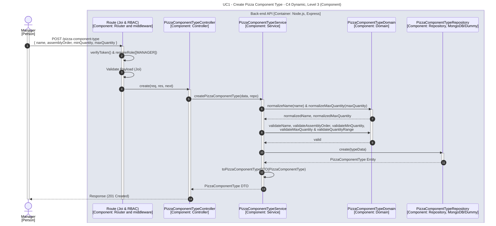

# UC1 - Create Pizza Component Type

| Attribute | Value |
|---|---|
| C4 view | Dynamic diagram, Level 3 (Component) |
| SAD view | Process View, Level 3 |
| Container | Back-end API |
| Endpoint | `POST /pizza-component-type` |
| Allowed roles | MANAGER |
| Success response | 201 Created |
| Error handling | Happy path only |

## Description

A Manager creates a pizza component type (name, assembly order, minimum and maximum quantity). The domain normalizes and validates the input before the type is persisted.

## Diagram

See the [README](./README.md) for the notation key and the element catalogue.
