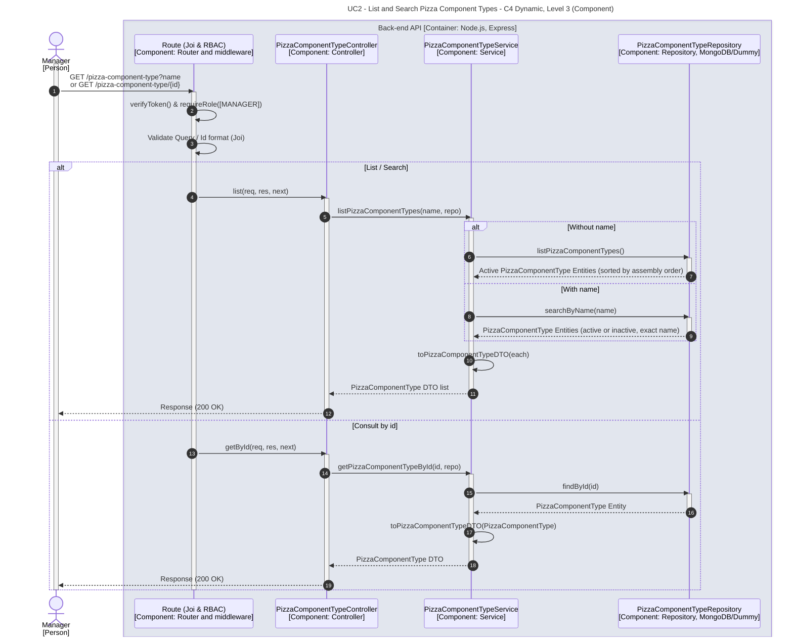

# UC2 - List and Search Pizza Component Types

| Attribute | Value |
|---|---|
| C4 view | Dynamic diagram, Level 3 (Component) |
| SAD view | Process View, Level 3 |
| Container | Back-end API |
| Endpoint | `GET /pizza-component-type?name, GET /pizza-component-type/{id}` |
| Allowed roles | MANAGER |
| Success response | 200 OK |
| Error handling | Happy path only |

## Description

A Manager lists the active pizza component types (sorted by assembly order), searches them by exact name (active or inactive), or consults a single type by id.

## Diagram

See the [README](./README.md) for the notation key and the element catalogue.
