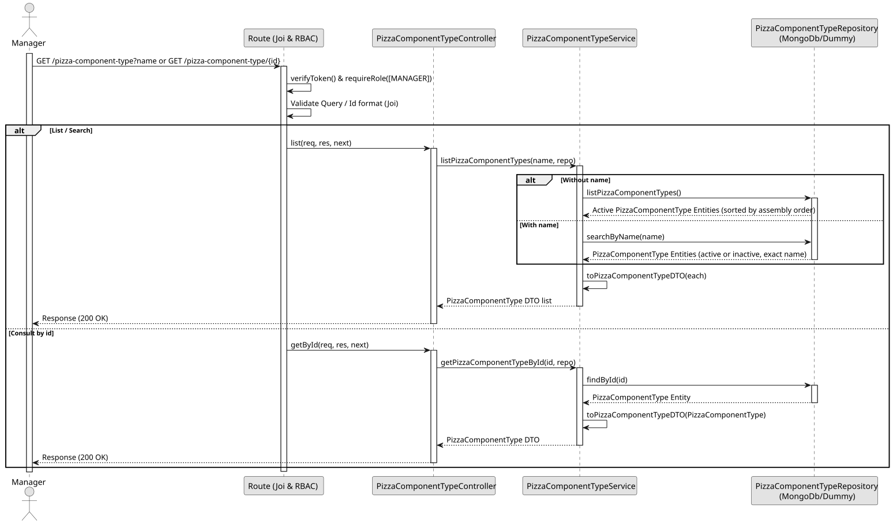

# UC2 - List / Search Pizza Component Type

## 1. Domain Assumptions

- Listing without filter returns active types, sorted by assembly order;
- A type can be searched by its exact name;
- A partial or blank name returns an empty list;
- A type can be consulted by its identifier;
- The maximum quantity is an integer greater than or equal to 1, or unbounded, and cannot be lower than the minimum quantity;
- Only users with the `MANAGER` role are authorized to list or search a pizza component type.

## 2. Solution Design

## 3. Business Test Planning

- **Issolation Strategy:** All application tests use dependency injection via isolated in-memory dummies (`pizza-component-type.dummy.repository.js`), avoiding Mocking libraries entirely.
- **Application Tests (`pizza-component-type.service.test.js`):**
  - `listPizzaComponentTypes without a name returns the active types sorted by assembly order`
  - `listPizzaComponentTypes without a name does not return removed types`
  - `listPizzaComponentTypes finds the exact name ignoring case and accents`
  - `listPizzaComponentTypes finds a removed type by name and flags it as inactive`
  - `listPizzaComponentTypes returns an empty list for partial or blank names`
  - `getPizzaComponentTypeById returns the type or throws 404`
  - `getPizzaComponentTypeById also returns a removed type, flagged as inactive`

## 4. E2E Tests

- **Base Endpoint:** `GET /api/v1/pizza-component-type`
- **Validated Scenarios:**
  - Request with Bearer Token -> `401 Unauthorized`
  - Request with `EMPLOYEE` Bearer Token -> `403 Forbidden` (RBAC Enforcement)
  - List by `MANAGER` -> `200 OK`
  - Search by exact name -> `200 OK`
  - Search by partial, blank or unkown name -> `200 OK` with `[]`
  - Get by id -> `200 OK`
  - Get with unkown id -> `404 Not Found`
  - Get with invalid id -> `400 Bad Request`
