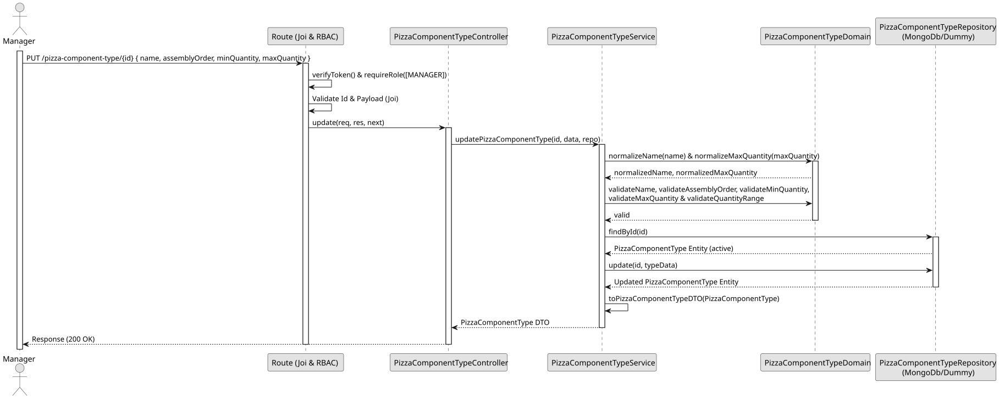

# UC3 - Update Pizza Component Type

## 1. Domain Assumptions

- The update may replace the name, the assembly order and the quantity limits;
- The new values follow the sames rules as in the creation;
- Only users with the `MANAGER` role are authorized to update a pizza component type.

## 2. Solution Design

## 3. Business Test Planning

- **Issolation Strategy:** All application tests use dependency injection via isolated in-memory dummies (`pizza-component-type.dummy.repository.js`), avoiding Mocking libraries entirely.
- **Application Tests (`pizza-component-type.service.test.js`):**
  - `updatePizzaComponentType changes all the properties`
  - `updatePizzaComponentType keeps its own assembly order and allows changing only the case of its name`
  - `updatePizzaComponentType rejects invalid data without changing the type`
  - `updatePizzaComponentType returns 409 Conflict on duplicate name`
  - `updatePizzaComponentType returns 409 Conflict on duplicate assembly order`
  - `updatePizzaComponentType throws 404 if the type does not exist`
  - `updatePizzaComponentType validates the data before looking for the type`
  - `updatePizzaComponentType throws 404 for a removed type and leaves it unchanged`

## 4. E2E Tests

- **Base Endpoint:** `PUT /api/v1/pizza-component-type/{id}`
- **Validated Scenarios:**
  - Request with Bearer Token -> `401 Unauthorized`
  - Request with `EMPLOYEE` Bearer Token -> `403 Forbidden` (RBAC Enforcement)
  - Valid payload by `MANAGER` -> `200 OK`
  - Invalid id, empty body or maximum lower than minimum -> `400 Bad Request`
  - Unknown type -> `404 Not Found`
  - Name or assembly order of another type -> `409 Conflict`
