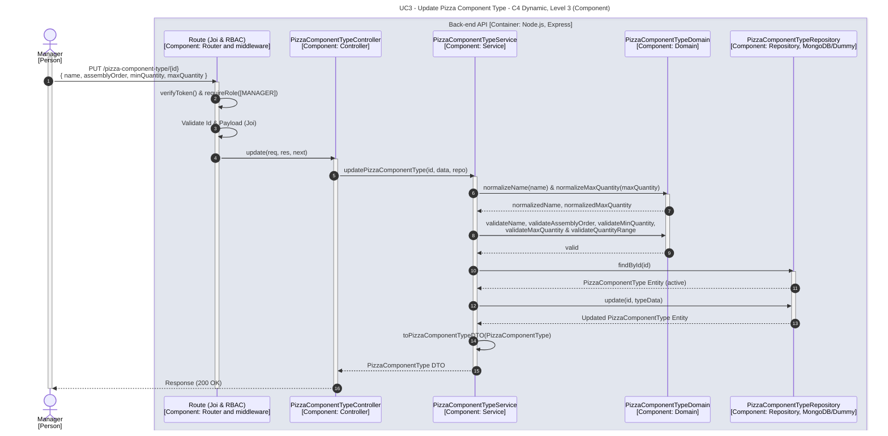

# UC3 - Update Pizza Component Type

| Attribute | Value |
|---|---|
| C4 view | Dynamic diagram, Level 3 (Component) |
| SAD view | Process View, Level 3 |
| Container | Back-end API |
| Endpoint | `PUT /pizza-component-type/{id}` |
| Allowed roles | MANAGER |
| Success response | 200 OK |
| Error handling | Happy path only |

## Description

A Manager updates a pizza component type. The domain normalizes and validates the input before the stored type is updated.

## Diagram

See the [README](./README.md) for the notation key and the element catalogue.
