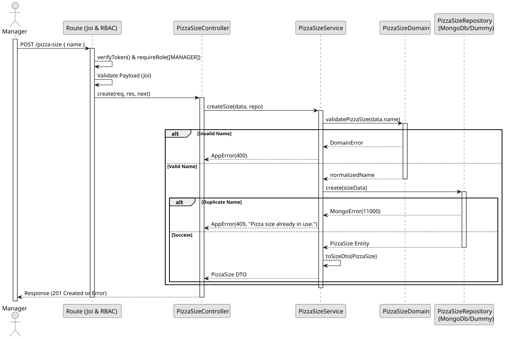

# UC1: Create Pizza Size

## Use Case View

**Primary Actor:** Manager  
**Description:** Allows a manager to create a new pizza size in the system, ensuring its name is unique and descriptive.

**Preconditions:**

- The user must be authenticated and have the `MANAGER` role.

**Main Success Scenario:**

1. The Manager provides a valid payload with the pizza size name.
2. The System validates that the name is not empty and has a valid format.
3. The System verifies that the pizza size name is unique.
4. The System creates and saves the new pizza size.
5. The System returns the newly created pizza size details with a 201 Created status.

**Alternative Flows:**

- _Missing mandatory fields or invalid format:_ The System throws a 400 Bad Request error.
- _Request by unauthorized user (No token or Employee):_ The System throws a 401 Unauthorized or 403 Forbidden error.
- _Duplicate pizza size name:_ The System throws a 409 Conflict error.

**Postconditions:**

- The new pizza size is saved in the database.

## 1. Domain Assumptions

- Pizza Sizes must have a unique and descriptive name;
- The name is mandatory and cannot be empty;
- Only users with the `MANAGER` role are authorized to create a new pizza size.

## 2. Solution Design

## 3. Business Test Planning

- **Isolation Strategy:** All application tests use dependency injection via isolated in-memory Dummies (`pizza-size.dummy.repository.js`), avoiding Mocking libraries entirely.
- **Domain Tests (`pizza-size.domain.test.js`):**
  - `validatePizzaSize rejects invalid data types and formats`
  - `validatePizzaSize accepts valid strings`
- **Application Tests (`pizza-size.service.test.js`):**
  - `createSize creates a new size and returns DTO`
  - `createSize returns 409 Conflict on duplicate name`

## 4. Postman E2E Tests

- **Base Endpoint:** `POST /api/v1/pizza-size`
- **Validated Scenarios:**
  - Request without Bearer Token -> `401 Unauthorized`
  - Request with `EMPLOYEE` Bearer Token -> `403 Forbidden` (RBAC enforcement)
  - Valid payload by `MANAGER` -> `201 Created`
  - Missing mandatory fields -> `400 Bad Request` (Joi validation)
  - Duplicate pizza size name -> `409 Conflict`
