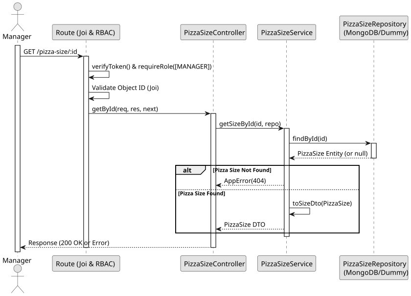

# UC3: Get Pizza Size by ID

## Use Case View

**Primary Actor:** Manager  
**Description:** Allows an authenticated manager to retrieve the details of a specific pizza size by its unique ID.

**Preconditions:**

- The user must be authenticated and have the `MANAGER` role.

**Main Success Scenario:**

1. The Manager provides the ID of the target pizza size.
2. The System validates the MongoDB ObjectId format of the ID.
3. The System searches the database for a pizza size matching the ID.
4. The System maps the entity to a DTO and returns it with a 200 OK status.

**Alternative Flows:**

- _Invalid ID format:_ The System throws a 400 Bad Request error.
- _Pizza size not found:_ The System throws a 404 Not Found error.
- _Request by unauthorized user:_ The System throws a 401 Unauthorized or 403 Forbidden error.

**Postconditions:**

- None (Read-only operation).

## 1. Domain Assumptions

- Pizza sizes can be queried individually by their unique ID;
- The ID must conform to the MongoDB ObjectId format;
- Only users with the `MANAGER` role can view pizza size details directly.

## 2. Solution Design

## 3. Business Test Planning

- **Isolation Strategy:** All application tests use dependency injection via isolated in-memory Dummies (`pizza-size.dummy.repository.js`), avoiding Mocking libraries entirely.
- **Application Tests (`pizza-size.service.test.js`):**
  - `getSizeById returns correct size or throws 404`

## 4. Postman E2E Tests

- **Base Endpoint:** `GET /api/v1/pizza-size/:id`
- **Validated Scenarios:**
  - Request without Bearer Token -> `401 Unauthorized`
  - Request with `EMPLOYEE` Bearer Token -> `403 Forbidden` (RBAC enforcement)
  - Request with invalid ID format -> `400 Bad Request` (Joi CastError prevention)
  - Request with non-existent ID -> `404 Not Found`
  - Request with valid ID -> `200 OK` (Returns pizza size DTO)
