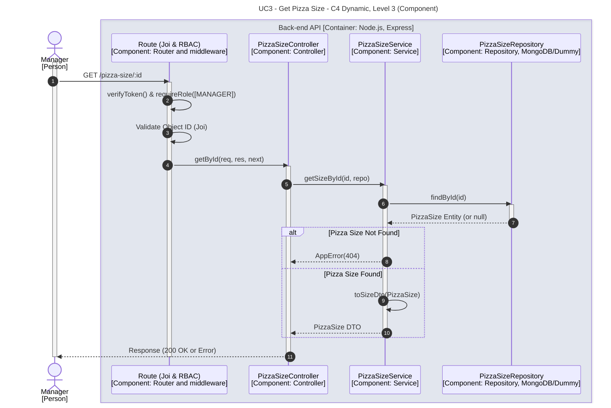

# UC3 - Get Pizza Size

| Attribute | Value |
|---|---|
| C4 view | Dynamic diagram, Level 3 (Component) |
| SAD view | Process View, Level 3 |
| Container | Back-end API |
| Endpoint | `GET /pizza-size/:id` |
| Allowed roles | MANAGER |
| Success response | 200 OK |
| Error handling | 404 (pizza size not found) |

## Description

A Manager consults a single pizza size by its id.

## Diagram

See the [README](./README.md) for the notation key and the element catalogue.
