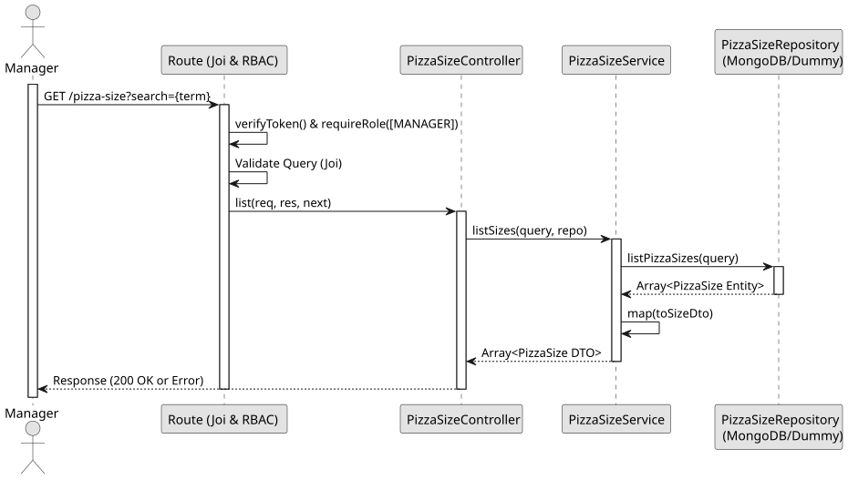

# UC2: List and Search Pizza Sizes

## 1. Domain Assumptions
* The system allows listing all pizza sizes or filtering them based on a search term;
* The search term performs a case-insensitive partial match on the pizza size name;
* Only users with the `MANAGER` role can view the pizza sizes list via this specific endpoint in this sprint.

## 2. Solution Design

## 3. Business Test Planning
* **Isolation Strategy:** All application tests use dependency injection via isolated in-memory Dummies (`pizza-size.dummy.repository.js`), avoiding Mocking libraries entirely.
* **Application Tests (`pizza-size.service.test.js`):**
    * `listSizes returns all sizes or filters by search query`

## 4. Postman E2E Tests
* **Base Endpoint:** `GET /api/v1/pizza-size`
* **Validated Scenarios:**
    * Request without Bearer Token -> `401 Unauthorized`
    * Request with `EMPLOYEE` Bearer Token -> `403 Forbidden` (RBAC enforcement)
    * Valid request without search query -> `200 OK` (Returns matched pizza sizes)
    * Valid request with non-matching search query -> `200 OK` (Returns `[]`)