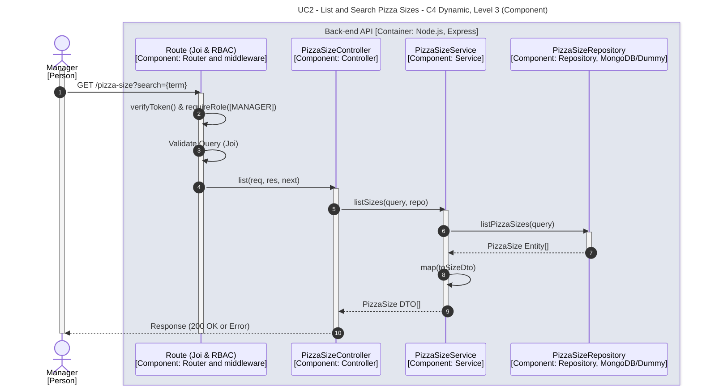

# UC2 - List and Search Pizza Sizes

| Attribute | Value |
|---|---|
| C4 view | Dynamic diagram, Level 3 (Component) |
| SAD view | Process View, Level 3 |
| Container | Back-end API |
| Endpoint | `GET /pizza-size?search={term}` |
| Allowed roles | MANAGER |
| Success response | 200 OK |
| Error handling | Not detailed (generic error response) |

## Description

A Manager lists the pizza sizes, optionally filtered by a search term.

## Diagram

See the [README](./README.md) for the notation key and the element catalogue.
