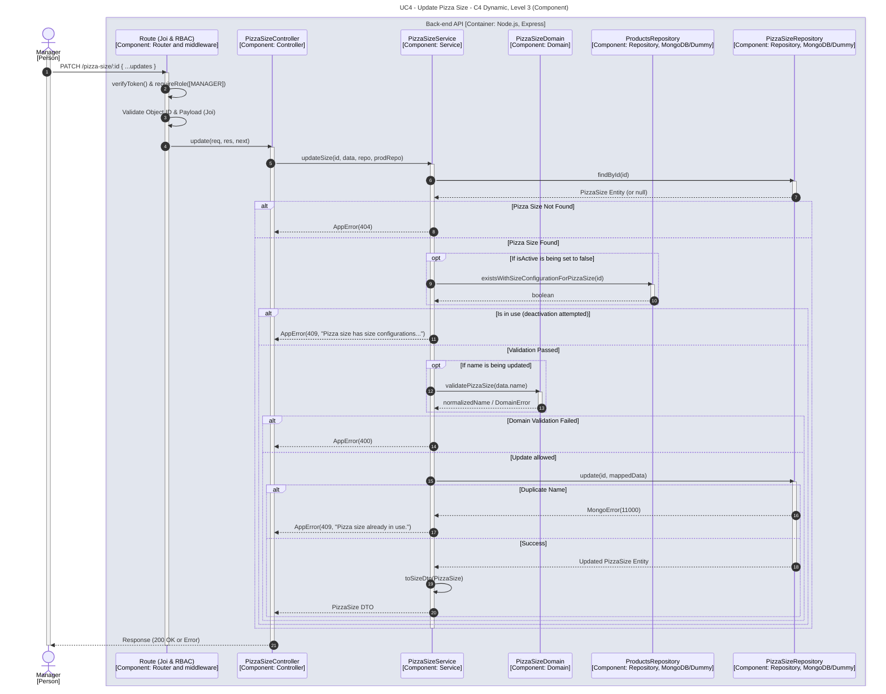

# UC4 - Update Pizza Size

| Attribute | Value |
|---|---|
| C4 view | Dynamic diagram, Level 3 (Component) |
| SAD view | Process View, Level 3 |
| Container | Back-end API |
| Endpoint | `PATCH /pizza-size/:id` |
| Allowed roles | MANAGER |
| Success response | 200 OK |
| Error handling | 404 (pizza size not found), 409 (size in use or name already in use), 400 (invalid name) |

## Description

A Manager partially updates a pizza size. Deactivating a size is rejected while product size configurations still use it, a new name is validated by the domain and a duplicated name results in a conflict error.

## Diagram

See the [README](./README.md) for the notation key and the element catalogue.
