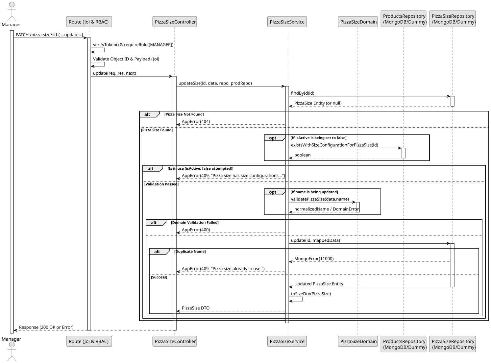

# UC4: Update and Deactivate Pizza Size

## 1. Domain Assumptions
* Pizza sizes can be partially updated (e.g., renaming);
* Pizza sizes can be logically deleted (deactivated) by setting `isActive: false`;
* **Crucial Rule:** A pizza size cannot be deactivated if it is currently in use by any product's component size configuration. This prevents compromising existing business information;
* Updating the name requires the new name to be unique and domain-validated;
* Only users with the `MANAGER` role can update pizza sizes.

## 2. Solution Design

## 3. Business Test Planning
* **Isolation Strategy:** All application tests use dependency injection via isolated in-memory Dummies (`pizza-size.dummy.repository.js` and `products.dummy.repository.js`), avoiding Mocking libraries entirely.
* **Domain Tests (`pizza-size.domain.test.js`):**
    * `validatePizzaSize rejects invalid data types and formats`
    * `validatePizzaSize accepts valid strings`
* **Application Tests (`pizza-size.service.test.js`):**
    * `updateSize modifies partial data safely`
    * `updateSize refuses to deactivate a size used by a size configuration`
    * `updateSize deactivates a size when only other sizes are used by configurations`
    * `updateSize still allows renaming a size used by a size configuration`
    * `updateSize throws 404 for unknown IDs and 409 for duplicate names`

## 4. Postman E2E Tests
* **Base Endpoint:** `PATCH /api/v1/pizza-size/:id`
* **Validated Scenarios:**
  * Request without Bearer Token -> `401 Unauthorized`
  * Request with `EMPLOYEE` Bearer Token -> `403 Forbidden` (RBAC enforcement)
  * Empty JSON payload -> `400 Bad Request` (Requires at least one field to update)
  * Invalid ID format -> `400 Bad Request`
  * Non-existent ID -> `404 Not Found`
  * Duplicate name -> `409 Conflict`
  * Deactivation when in use by size configurations -> `409 Conflict`
  * Valid partial update or deactivation -> `200 OK`