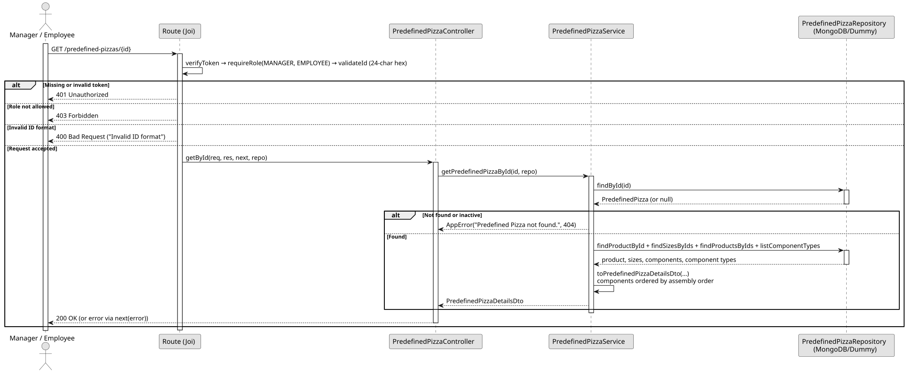

# UC3: Consult Predefined Pizza by ID

## Use Case View

**Primary Actor:** Manager / Employee  
**Description:** Allows an authenticated user to consult the details of an active Predefined Pizza using its unique ID.

**Preconditions:**

- The user must be authenticated and have the `MANAGER` or `EMPLOYEE` role.

**Main Success Scenario:**

1. The User provides the ID of the Predefined Pizza.
2. The System validates that the ID is a 24-character hexadecimal string.
3. The System searches the database for a Predefined Pizza matching the ID and verifies that it is active.
4. The System retrieves its product, Pizza Sizes, components and Pizza Component Types.
5. The System builds the details, with the components ordered by assembly order, and returns them with a 200 OK status.

**Alternative Flows:**

- _Invalid ID format:_ The System throws a 400 Bad Request error.
- _Predefined Pizza not found or deactivated:_ The System throws a 404 Not Found error.
- _Request by unauthorized user (No token or role not allowed):_ The System throws a 401 Unauthorized or 403 Forbidden error.

**Postconditions:**

- None (Read-only operation).

## 1. Domain Assumptions

Due to a lack of client clarification, the following domain restrictions were assumed in the code:

- The identifier is a 24-character hexadecimal string (MongoDB ObjectId);
- A deactivated Predefined Pizza is treated as if it did not exist (404 Not Found);
- The details contain the product (`id`, `name`), the sizes (`id`, `name`, `isActive`) and the components of the default configuration, each with its Pizza Component Type, ordered by assembly order;
- Both the `MANAGER` and `EMPLOYEE` roles can consult a Predefined Pizza.

## 2. Solution Design

## 3. Business Test Planning

- All unit tests use isolated in-memory Dummy Repositories (`predefined-pizzas.dummy.repository.js`). The Mockito library isn't used in this project.
- **Scenario A:** Provide the id of an active Predefined Pizza. Result: The details are returned, with the product name, the sizes and the components ordered by assembly order (e.g. Base Dough, Base Sauce, Cheese, Topping), each with its Pizza Component Type and limits.
- **Scenario B:** Provide the id of a Predefined Pizza that was deactivated. Result: Throws `AppError` (404 Not Found).
- **Scenario C:** Provide an id that does not exist. Result: Throws `AppError` (404 Not Found).

## 4. Postman E2E Tests

- **Base Endpoint:** `GET /api/v1/predefined-pizzas/{id}`
- **Validated Scenarios:**
  - Existing id, as Employee -> `200 OK` (Returns the details)
  - Id with an invalid format -> `400 Bad Request` (Blocked by id validation)
  - Valid but unknown id -> `404 Not Found`
  - Id of a deactivated Predefined Pizza -> `404 Not Found`
