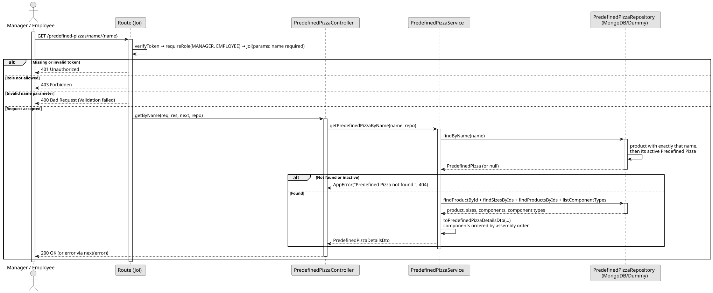

# UC4: Consult Predefined Pizza by Name

## Use Case View

**Primary Actor:** Manager / Employee  
**Description:** Allows an authenticated user to consult the details of an active Predefined Pizza using the exact name of the product that represents it.

**Preconditions:**

- The user must be authenticated and have the `MANAGER` or `EMPLOYEE` role.

**Main Success Scenario:**

1. The User provides the name of the product.
2. The System validates that the name is not empty.
3. The System searches the product whose name matches exactly (ignoring letter case) and retrieves its active Predefined Pizza.
4. The System retrieves its product, Pizza Sizes, components and Pizza Component Types.
5. The System builds the details, with the components ordered by assembly order, and returns them with a 200 OK status.

**Alternative Flows:**

- _Invalid or empty name:_ The System throws a 400 Bad Request error.
- _Unknown name, or product without an active Predefined Pizza:_ The System throws a 404 Not Found error.
- _Request by unauthorized user (No token or role not allowed):_ The System throws a 401 Unauthorized or 403 Forbidden error.

**Postconditions:**

- None (Read-only operation).

## 1. Domain Assumptions

Due to a lack of client clarification, the following domain restrictions were assumed in the code:

- A Predefined Pizza has no name of its own: the lookup uses the name of its product, which must match exactly (a partial name does not match), ignoring letter case;
- A name that belongs to a product without an active Predefined Pizza, or to no product, is treated as not found (404 Not Found);
- The details have the same content as in UC3;
- Both the `MANAGER` and `EMPLOYEE` roles can consult a Predefined Pizza.

## 2. Solution Design

## 3. Business Test Planning

- All unit tests use isolated in-memory Dummy Repositories (`predefined-pizzas.dummy.repository.js`). The Mockito library isn't used in this project.
- **Scenario A:** Provide the exact name of the product of an active Predefined Pizza (any letter case, e.g. `margherita`). Result: The details of that Predefined Pizza are returned.
- **Scenario B:** Provide a name that does not exist. Result: Throws `AppError` (404 Not Found).
- **Scenario C:** Provide the name of a product whose Predefined Pizza was deactivated. Result: Throws `AppError` (404 Not Found).

## 4. Postman E2E Tests

- **Base Endpoint:** `GET /api/v1/predefined-pizzas/name/{name}`
- **Validated Scenarios:**
  - Exact product name, as Employee -> `200 OK` (Returns the details)
  - Unknown name -> `404 Not Found`
  - Name of a deactivated Predefined Pizza -> `404 Not Found`
