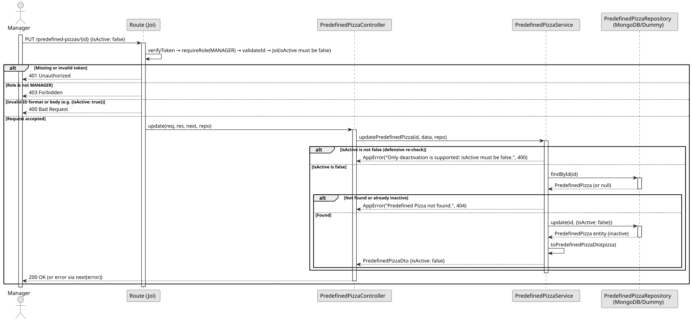

# UC6: Deactivate Predefined Pizza

## 1. Domain Assumptions
Due to a lack of client clarification, the following domain restrictions were assumed in the code:
* Predefined Pizzas are never deleted, only deactivated; a deactivated one cannot be reactivated;
* Only `{ "isActive": false }` is accepted as a deactivation; any other value of `isActive` is rejected;
* Deactivating does not change the product or the components, and the deactivation is not blocked by any reference check;
* Only users with the `MANAGER` role can deactivate Predefined Pizzas.

## 2. Solution Design

## 3. Business Test Planning
* All unit tests use isolated in-memory Dummy Repositories (`predefined-pizzas.dummy.repository.js`). The Mockito library isn't used in this project.
* **Scenario A:** Deactivate an active Predefined Pizza. Result: The Predefined Pizza is returned with `isActive: false` and is no longer returned by the list or by the consultations.
* **Scenario B:** Send `isActive: true`. Result: Throws `AppError` (400 Bad Request, only deactivation is supported).
* **Scenario C:** Deactivate a Predefined Pizza that does not exist. Result: Throws `AppError` (404 Not Found).
* **Scenario D:** Request the deactivation with the `EMPLOYEE` role. Result: The request is rejected (403 Forbidden) before reaching the service.

## 4. Postman E2E Tests

* **Base Endpoint:** `PUT /api/v1/predefined-pizzas/{id}`
* **Validated Scenarios:**
    * `{ "isActive": false }` -> `200 OK` (Returns the Predefined Pizza with `isActive: false`)
    * `{ "isActive": true }` -> `400 Bad Request` (Blocked by Joi validation)
    * Get by id and get by name after the deactivation -> `404 Not Found`
    * `EMPLOYEE` role -> `403 Forbidden`
