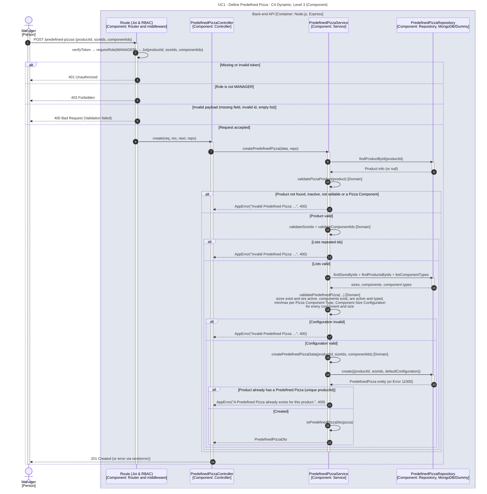

# UC1 - Define Predefined Pizza

| Attribute | Value |
|---|---|
| C4 view | Dynamic diagram, Level 3 (Component) |
| SAD view | Process View, Level 3 |
| Container | Back-end API |
| Endpoint | `POST /predefined-pizzas` |
| Allowed roles | MANAGER |
| Success response | 201 Created |
| Error handling | 401 (invalid token), 403 (role not allowed), 400 (invalid payload or configuration), 409 (predefined pizza already exists for the product) |

## Description

A Manager defines a predefined pizza for a sellable pizza product, choosing the available sizes and the default components. The service validates the product, the lists of ids and the whole configuration (sizes, components, limits per component type and component size configurations) before persisting it. Only one predefined pizza is allowed per product.

## Diagram

See the [README](./README.md) for the notation key and the element catalogue.
