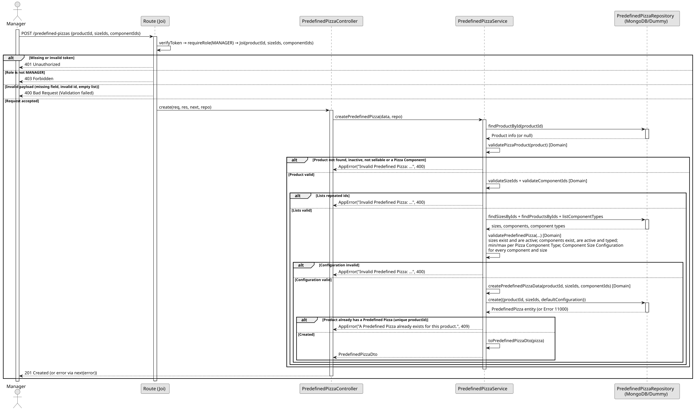

# UC1: Define Predefined Pizza

## 1. Domain Assumptions

Due to a lack of client clarification, the following domain restrictions were assumed in the code:

- A Predefined Pizza has no name of its own: it is represented by a sellable product, and there is at most one Predefined Pizza per product (unique index on `productId`);
- The product must be active, sellable and must not be a Pizza Component;
- The default configuration is a single list of Pizza Component ids, shared by all the sizes in which the pizza is available; no quantity is stored per component;
- The minimum and maximum of each Pizza Component Type count distinct components, and every type with a minimum greater than zero must be present;
- A size can only be used if it is active and every component of the default configuration has a Component Size Configuration for it;
- Unknown product, size or component ids are reported as invalid pizza data (400 Bad Request), not as 404;
- Only users with the `MANAGER` role can define Predefined Pizzas.

## 2. Solution Design

## 3. Business Test Planning

- All unit tests use isolated in-memory Dummy Repositories (`predefined-pizzas.dummy.repository.js`). The Mockito library isn't used in this project.
- **Scenario A:** Provide an active sellable product, active sizes and components that respect every rule (e.g. dough, sauce and cheese for Small and Large). Result: The Predefined Pizza is stored as active and returned with its `productId`, `sizeIds` and default configuration `componentIds`.
- **Scenario B:** Provide a product that does not exist, is inactive, is not sellable or is a Pizza Component. Result: Throws `AppError` (400 Bad Request).
- **Scenario C:** Provide an empty size list or a repeated component. Result: Throws `AppError` (400 Bad Request) and nothing is stored.
- **Scenario D:** Provide a configuration that breaks a rule: unknown, inactive or non-component product, no dough (below `minQuantity`), two doughs or two cheeses (above `maxQuantity`), unknown or inactive size, or a size without a Component Size Configuration for one of the components. Result: Throws `AppError` (400 Bad Request) and nothing is stored.
- **Scenario E:** Provide a minimal configuration (only dough) and several components of a type without maximum (toppings). Result: The Predefined Pizza is stored.
- **Scenario F:** Define a second Predefined Pizza for the same product. Result: Throws `AppError` (409 Conflict).
- **Scenario G:** Request the creation with the `EMPLOYEE` role. Result: The request is rejected (403 Forbidden) before reaching the service.

## 4. Postman E2E Tests

- **Base Endpoint:** `POST /api/v1/predefined-pizzas`
- **Validated Scenarios:**
  - Valid product, sizes and components -> `201 Created` (Returns the Predefined Pizza)
  - Second Predefined Pizza for the same product -> `409 Conflict`
  - Missing `productId`, invalid id or empty size list -> `400 Bad Request` (Blocked by Joi validation)
  - Repeated component -> `400 Bad Request`
  - Inactive component -> `400 Bad Request`
  - No dough (below `minQuantity`) -> `400 Bad Request`
  - Two cheeses (above `maxQuantity`) -> `400 Bad Request`
  - Size without Component Size Configuration -> `400 Bad Request`
  - Product that is a Pizza Component representing the pizza -> `400 Bad Request`
  - Missing token -> `401 Unauthorized`
  - `EMPLOYEE` role -> `403 Forbidden`
