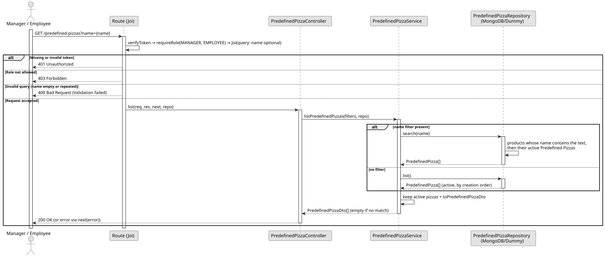

# UC2: List and Search Predefined Pizzas

## 1. Domain Assumptions
Due to a lack of client clarification, the following domain restrictions were assumed in the code:
* A Predefined Pizza has no name of its own, so the search by `name` matches the name of the product that represents it (partial, ignoring letter case);
* Only active Predefined Pizzas are listed; they follow the creation order and are not paginated;
* The list returns only the basic data (`id`, `productId`, `sizeIds`, default configuration `componentIds`, `isActive`); the full details are consulted in UC3 and UC4;
* Both the `MANAGER` and `EMPLOYEE` roles can list and search Predefined Pizzas.

## 2. Solution Design

## 3. Business Test Planning
* All unit tests use isolated in-memory Dummy Repositories (`predefined-pizzas.dummy.repository.js`). The Mockito library isn't used in this project.
* **Scenario A:** Request the list when active and deactivated Predefined Pizzas exist. Result: Only the active ones are returned.
* **Scenario B:** Request the list with a `name` filter (e.g. `MARGH`). Result: Only the active Predefined Pizzas whose product name contains the text (ignoring letter case) are returned.
* **Scenario C:** Request the list with a `name` that matches no product. Result: An empty list is returned (200 OK).
* **Scenario D:** Request the list with the `EMPLOYEE` role. Result: The list is returned (200 OK).

## 4. Postman E2E Tests

* **Base Endpoint:** `GET /api/v1/predefined-pizzas[?name=]`
* **Validated Scenarios:**
    * List without filter, as Manager -> `200 OK` (Returns the active Predefined Pizzas)
    * List without filter, as Employee -> `200 OK`
    * Search by the product name, as Employee -> `200 OK` (Returns the created pizza)
    * Search without results -> `200 OK` (Returns `[]`)
    * Empty `name` -> `400 Bad Request` (Blocked by Joi validation)
