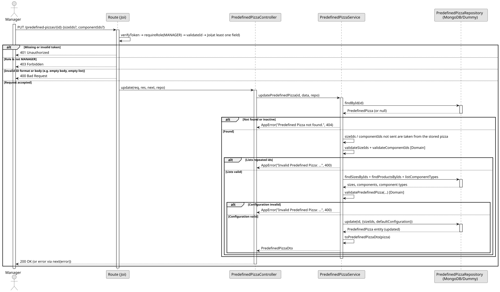

# UC5: Update Predefined Pizza

## Use Case View

**Primary Actor:** Manager  
**Description:** Allows a manager to replace the Pizza Sizes and/or the default configuration of an active Predefined Pizza.

**Preconditions:**

- The user must be authenticated and have the `MANAGER` role.
- The Predefined Pizza must exist and be active.

**Main Success Scenario:**

1. The Manager provides the ID of the Predefined Pizza and a payload with the new `sizeIds` and/or `componentIds`.
2. The System validates the ID format and that the payload contains at least one field and no empty lists.
3. The System finds the Predefined Pizza and verifies that it is active.
4. The System keeps the stored value of the list that was not sent.
5. The System revalidates the resulting configuration with the same rules as in the definition (repeated ids, active sizes, active components, Pizza Component Type limits and Component Size Configurations).
6. The System replaces the stored lists with the new ones.
7. The System returns the updated Predefined Pizza with a 200 OK status.

**Alternative Flows:**

- _Invalid ID, empty payload or empty lists:_ The System throws a 400 Bad Request error.
- _Repeated ids or configuration that breaks a rule:_ The System throws a 400 Bad Request error.
- _Predefined Pizza not found or already deactivated:_ The System throws a 404 Not Found error.
- _Request by unauthorized user (No token or Employee):_ The System throws a 401 Unauthorized or 403 Forbidden error.

**Postconditions:**

- The Pizza Sizes and/or the default configuration of the Predefined Pizza are updated in the database.

## 1. Domain Assumptions

Due to a lack of client clarification, the following domain restrictions were assumed in the code:

- Only the sizes and the default configuration can be changed; the product that represents the pizza cannot;
- The lists sent replace the stored ones (they are not merged); the list that is not sent keeps its stored value;
- Whenever sizes or components are sent, the configuration is revalidated with the same rules as in UC1;
- At least one of `sizeIds`, `componentIds` or `isActive` must be sent;
- Only users with the `MANAGER` role can update Predefined Pizzas.

## 2. Solution Design

## 3. Business Test Planning

- All unit tests use isolated in-memory Dummy Repositories (`predefined-pizzas.dummy.repository.js`). The Mockito library isn't used in this project.
- **Scenario A:** Send a new valid list of components. Result: The default configuration is replaced and the sizes are kept.
- **Scenario B:** Send a new valid list of sizes. Result: The sizes are replaced and the default configuration is kept.
- **Scenario C:** Send a list that breaks a rule (e.g. no dough, or an inactive component). Result: Throws `AppError` (400 Bad Request).
- **Scenario D:** Send an empty body. Result: Throws `AppError` (400 Bad Request).
- **Scenario E:** Update a Predefined Pizza that does not exist. Result: Throws `AppError` (404 Not Found).
- **Scenario F:** Request the update with the `EMPLOYEE` role. Result: The request is rejected (403 Forbidden) before reaching the service.

## 4. Postman E2E Tests

- **Base Endpoint:** `PUT /api/v1/predefined-pizzas/{id}`
- **Validated Scenarios:**
  - New valid `componentIds` -> `200 OK` (Returns the updated Predefined Pizza)
  - New valid `sizeIds` -> `200 OK`
  - Invalid configuration (inactive component) -> `400 Bad Request`
  - Empty body -> `400 Bad Request` (Blocked by Joi validation)
