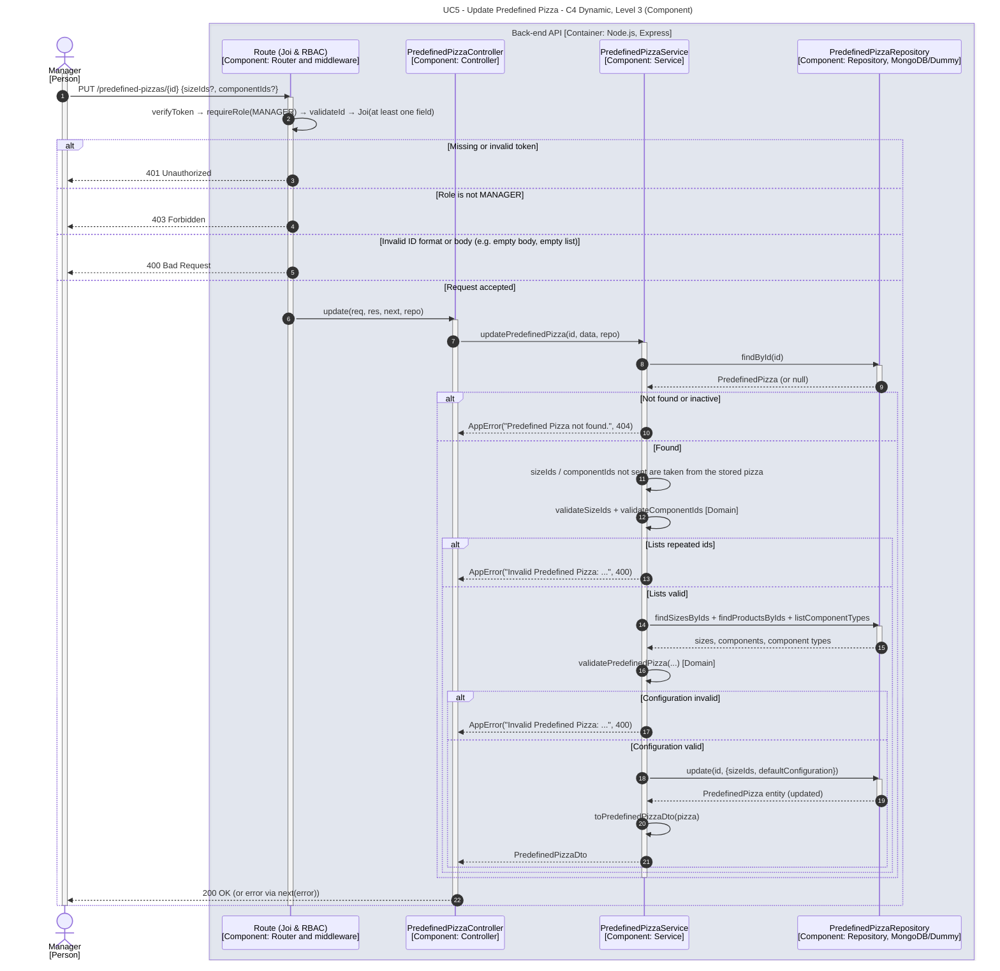

# UC5 - Update Predefined Pizza

| Attribute | Value |
|---|---|
| C4 view | Dynamic diagram, Level 3 (Component) |
| SAD view | Process View, Level 3 |
| Container | Back-end API |
| Endpoint | `PUT /predefined-pizzas/{id}` |
| Allowed roles | MANAGER |
| Success response | 200 OK |
| Error handling | 401 (invalid token), 403 (role not allowed), 400 (invalid id, body or configuration), 404 (predefined pizza not found or inactive) |

## Description

A Manager updates the sizes and/or the components of a predefined pizza. Fields that are not sent are taken from the stored pizza and the resulting configuration is validated again as a whole.

## Diagram

See the [README](./README.md) for the notation key and the element catalogue.
