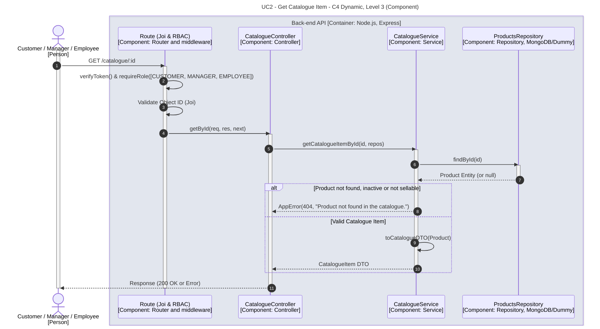

# UC2 - Get Catalogue Item

| Attribute | Value |
|---|---|
| C4 view | Dynamic diagram, Level 3 (Component) |
| SAD view | Process View, Level 3 |
| Container | Back-end API |
| Endpoint | `GET /catalogue/:id` |
| Allowed roles | CUSTOMER, MANAGER, EMPLOYEE |
| Success response | 200 OK |
| Error handling | 404 (product not found, inactive or not sellable) |

## Description

A Customer, Manager or Employee consults a single catalogue item. Only active and sellable products are visible in the catalogue.

## Diagram

See the [README](./README.md) for the notation key and the element catalogue.
