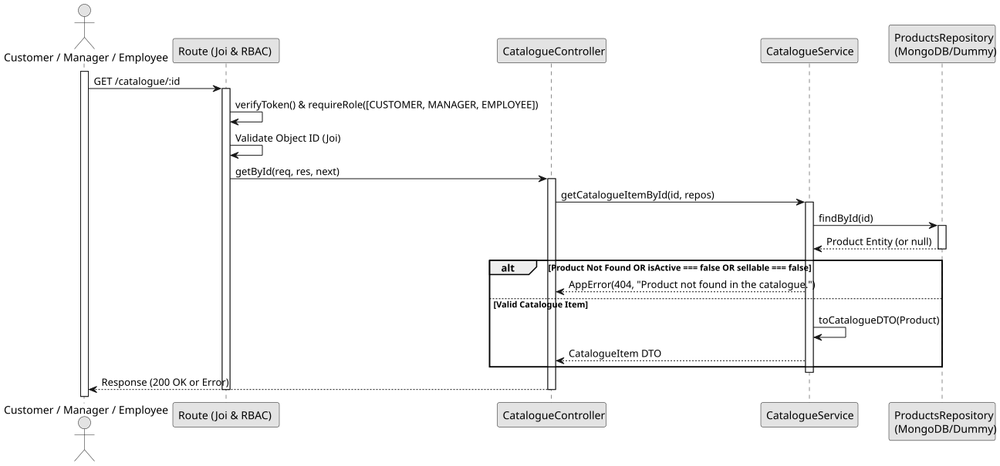

# UC2: Get Catalogue Item by ID

## 1. Domain Assumptions

- Catalogue items can be queried individually by their unique product ID.
- **Crucial Rule:** The product must exist, be active (`isActive: true`), and be designated as sellable (`sellable: true`). If any of these conditions fail, the product is considered "not found in the catalogue".
- The ID must conform to the MongoDB ObjectId format.
- Users with `CUSTOMER`, `MANAGER`, and `EMPLOYEE` roles can view catalogue item details.

## 2. Solution Design

## 3. Business Test Planning

- **Isolation Strategy:** All application tests use dependency injection via isolated in-memory Dummies (`products.dummy.repository.js`), avoiding Mocking libraries entirely.
- **Application Tests (`product-catalogue.service.test.js`):**
  - `getCatalogueItemById returns the correct Catalogue DTO for a valid, active, and sellable product`
  - `getCatalogueItemById throws 404 AppError if the product does not exist`
  - `getCatalogueItemById throws 404 AppError if the product is inactive`
  - `getCatalogueItemById throws 404 AppError if the product is not sellable`

## 4. Postman E2E Tests

- **Base Endpoint:** `GET /api/v1/catalogue/:id`
- **Validated Scenarios:**
  - Request without Bearer Token -> `401 Unauthorized`
  - Request with invalid ID format -> `400 Bad Request` (Joi CastError prevention)
  - Request for a non-existent Product ID -> `404 Not Found`
  - Request for an inactive or non-sellable Product ID -> `404 Not Found`
  - Request for a valid, active, sellable Product ID by allowed roles -> `200 OK` (Returns Catalogue DTO)
