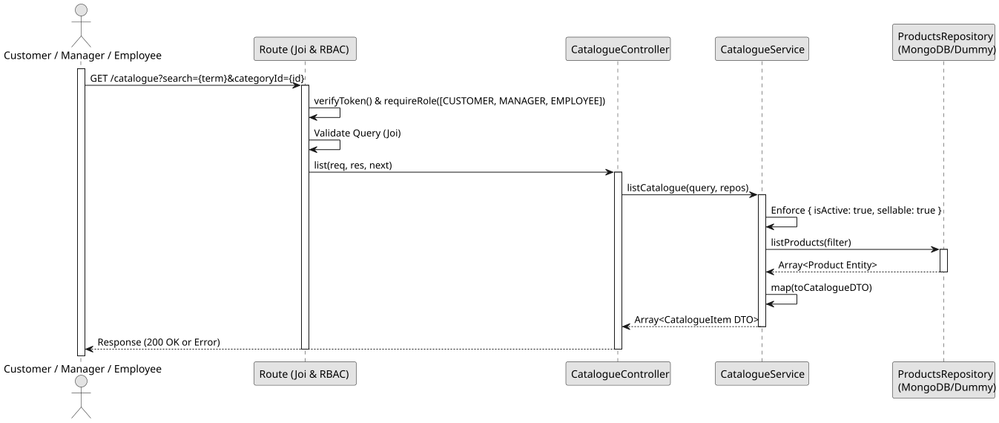

# UC1: List and Search Catalogue

## Use Case View

**Primary Actor:** Customer / Manager / Employee  
**Description:** Allows an authenticated user to list the products currently offered for sale, optionally filtering them by a search term and/or category.

**Preconditions:**

- The user must be authenticated and have the `CUSTOMER`, `MANAGER` or `EMPLOYEE` role.

**Main Success Scenario:**

1. The User requests the catalogue, optionally providing query filters (`search`, `categoryId`).
2. The System validates the query parameters.
3. The System forces the filters `isActive: true` and `sellable: true`.
4. The System queries the database for the matching products, applying a case-insensitive partial match for the search term across names and descriptions.
5. The System maps the found products to Catalogue DTOs, including category, allergens and available sizes.
6. The System returns the list of catalogue items with a 200 OK status.

**Alternative Flows:**

- _No matching products found:_ The System returns an empty list `[]` with a 200 OK status.
- _Invalid `categoryId` format or search term too long:_ The System throws a 400 Bad Request error.
- _Request by unauthorized user (No token):_ The System throws a 401 Unauthorized error.

**Postconditions:**

- None (Read-only operation).

## 1. Domain Assumptions

- The product catalogue exposes products to be viewed by customers and staff.
- **Crucial Rule:** Only products that are both active (`isActive: true`) and designated as sellable (`sellable: true`) are returned by the catalogue.
- The system allows listing the catalogue items or filtering them based on a search term and/or category ID.
- The search term performs a case-insensitive partial match across the product's `name` and `description`.
- Users with `CUSTOMER`, `MANAGER`, and `EMPLOYEE` roles are authorized to list and search the catalogue.

## 2. Solution Design

## 3. Business Test Planning

- **Isolation Strategy:** All application tests use dependency injection via isolated in-memory Dummies (`products.dummy.repository.js`), avoiding Mocking libraries entirely.
- **Application Tests (`product-catalogue.service.test.js`):**
  - `listCatalogue forces isActive and sellable filters on the repository query`
  - `listCatalogue returns all valid catalogue items when no query is provided`
  - `listCatalogue filters products by search term (name/description) and categoryId`
  - `listCatalogue correctly maps product entities to Catalogue DTOs, including nested categories, allergens, and available sizes`

## 4. Postman E2E Tests

- **Base Endpoint:** `GET /api/v1/catalogue`
- **Validated Scenarios:**
  - Request without Bearer Token -> `401 Unauthorized`
  - Valid request without filters by `CUSTOMER`, `MANAGER`, or `EMPLOYEE` -> `200 OK` (Returns all sellable active products)
  - Valid request with matching `search` or `categoryId` filters -> `200 OK`
  - Valid request with non-matching filters -> `200 OK` (Returns `[]`)
