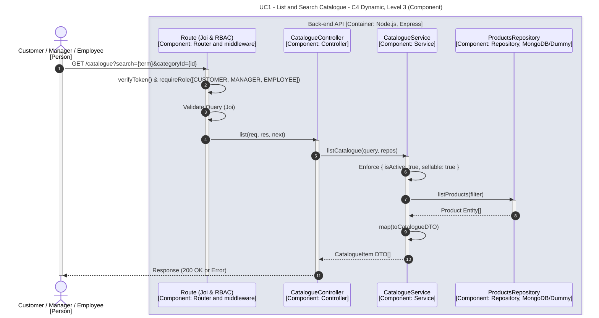

# UC1 - List and Search Catalogue

| Attribute | Value |
|---|---|
| C4 view | Dynamic diagram, Level 3 (Component) |
| SAD view | Process View, Level 3 |
| Container | Back-end API |
| Endpoint | `GET /catalogue?search={term}&categoryId={id}` |
| Allowed roles | CUSTOMER, MANAGER, EMPLOYEE |
| Success response | 200 OK |
| Error handling | Not detailed (generic error response) |

## Description

A Customer, Manager or Employee lists the catalogue, optionally filtered by a search term and a category. The service always restricts the result to active and sellable products.

## Diagram

See the [README](./README.md) for the notation key and the element catalogue.
