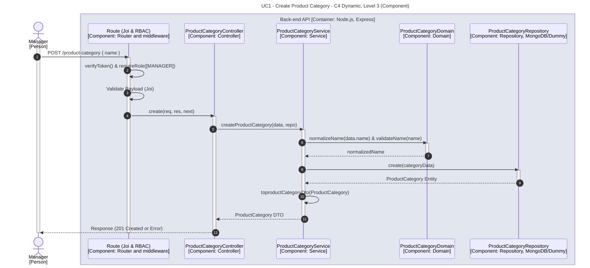

# UC1 - Create Product Category

| Attribute | Value |
|---|---|
| C4 view | Dynamic diagram, Level 3 (Component) |
| SAD view | Process View, Level 3 |
| Container | Back-end API |
| Endpoint | `POST /product-category` |
| Allowed roles | MANAGER |
| Success response | 201 Created |
| Error handling | Happy path only |

## Description

A Manager creates a product category. The domain normalizes and validates the name before the category is persisted.

## Diagram

See the [README](./README.md) for the notation key and the element catalogue.
