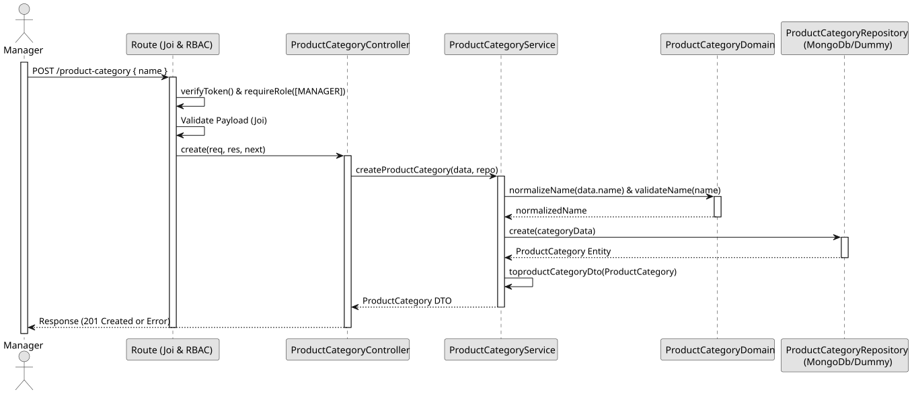

# UC1 - Create Product Category

## 1. Domain Assumptions

- Product Categories must have a unique name and identifier;
- The name is mandatory and cannot be empty;
- The name of a removed category can be reused by a new one;
- Only users with the `Manager` role are authorized to create a new product category.

## 2. Solution Design

## 3. Business Test Planning

- **Isolation Strategy:** All aplication tests use dependency injection via isolated in-memory dummies (`product-categories.dummy.repository.js`), avoiding Mocking libraries entirely.
- **Domain Tests (`product-categories.domain.test.js`):**
  - `normalizeName removes leading, trailing and repeated spaces`
  - `validateName rejects missing, blank and non-text names`
  - `validateName accepts valid names`
- **Application Tests (`product-categories.service.test.js`):**
  - `createProductCategory saves a normalized name and returns a DTO`
  - `createProductCategory rejects blank or missing names without saving`
  - `createProductCategory returns 409 Conflict on duplicate name`
  - `createProductCategory can reuse the name of an inactive category`

## 4. E2E Tests

- **Base Endpoint:** `POST /api/v1/product-categories`
- **Validated Scenarios:**
  - Request without Bearer Token -> `401 Unauthorized`
  - Request with `EMPLOYEE` Bearer Token -> `403 Forbidden` (RBAC Enforcement)
  - Valid payload by `MANAGER` -> `201 Created`
  - Missing, blank or invalid name -> `400 Bad Request` (Joi validation)
  - Duplicate category name -> `409 Conflict`
