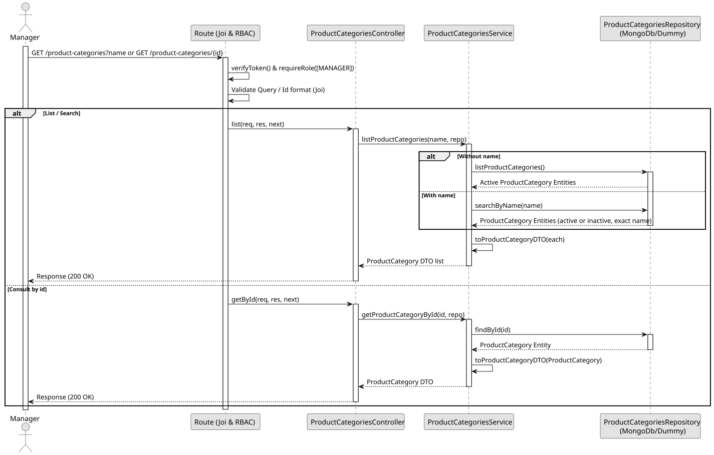

# UC2 - List / Search Product Categories

## Use Case View

**Primary Actor:** Manager  
**Description:** Allows a manager to list active product categories, search for a category by its exact name, or consult a category by its identifier.

**Preconditions:**

- The user must be authenticated and have the `MANAGER` role.

**Main Success Scenario:**

1. The Manager requests the product categories (optionally providing a name query or specific ID).
2. If no filter is applied, the System returns all active categories.
3. If an exact name is searched, the System finds the category (ignoring case and accents), even if inactive, and returns it.
4. If a specific ID is provided, the System retrieves the associated category (active or inactive).
5. The System returns a 200 OK response with the requested data.

**Alternative Flows:**

- _Partial or blank name search:_ The System returns an empty list (`[]`) with a 200 OK status.
- _Unknown ID requested:_ The System throws a 404 Not Found error.
- _Invalid ID requested:_ The System throws a 400 Bad Request error.

**Postconditions:**

- None (Read-only operation).

## 1. Domain Assumptions

- Listing without filtering returns only active categories;
- A category can be searched by name, and the search can also return removed (inactive) categories.
- A partial or blank name returns an empty list;
- A category can be consulted by its identifier even if it is inactive;
- Only users with the `MANAGER` role are authorized to list and search product categories.

## 2. Solution Design

## 3. Business Test Planning

- **Isolation Strategy:** All aplication tests use dependency injection via isolated in-memory dummies (`product-categories.dummy.repository.js`), avoiding Mocking libraries entirely.
- **Application Tests (`product-categories.service.test.js`):**
  - `listProductCategories without a name returns the active categories`
  - `listProductCategories finds the exact name ignoring case and accents`
  - `listProductCategories returns an empty list for partial or blank names`
  - `getProductCategoryById returns the category or throws 404`
  - `an inactive category is not listed but can still be found and consulted`

## 4. E2E Tests

- **Base Endpoint:** `GET /api/v1/product-categories`
- **Validated Scenarios:**
  - Request without Bearer Token -> `401 Unauthorized`
  - Request with `EMPLOYEE` Bearer Token -> `403 Forbidden` (RBAC Enforcement)
  - List by `MANAGER` -> `200 OK` (only active categories)
  - Search by exact name -> `200 OK`
  - Search by partial or unknown name -> `200 OK` with `[]`
  - Get by id -> `200 OK`
  - Get with unknown id -> `404 Not Found`
  - Get with invalid id -> `400 Bad Request`
