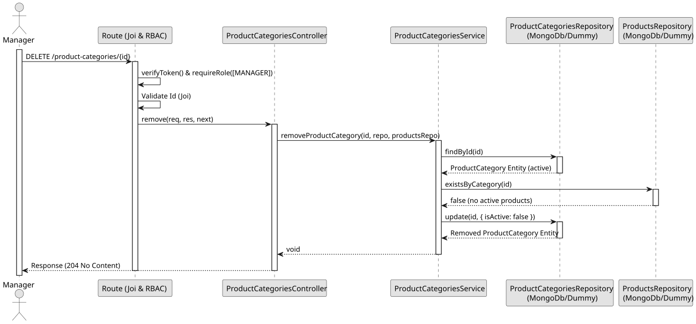

# UC4 - Remove Product Category

## Use Case View

**Primary Actor:** Manager  
**Description:** Allows a manager to update the name of an existing, active product category.

**Preconditions:**

- The user must be authenticated and have the `Manager` role.
- The target category must exist and be active.

**Main Success Scenario:**

1. The Manager provides the category ID and a valid payload with the new name.
2. The System validates the ID and payload.
3. The System verifies that the category exists and is not removed/inactive.
4. The System verifies that the new name follows the rules and is not already in use by another category (allows changing the case of its own name).
5. The System updates the name and persists the changes.
6. The System returns a 200 OK response with the updated data.

**Alternative Flows:**

- _Invalid ID or blank name:_ The System throws a 400 Bad Request error.
- _Category not found:_ The System throws a 404 Not Found error.
- _Category is already inactive/removed:_ The System throws a 409 Conflict error.
- _Duplicate category name:_ The System throws a 409 Conflict error.

**Postconditions:**

- The product category is updated with the new name.

## 1. Domain Assumptions

- The removal is logical: the category becomes inactive;
- A category referenced by a product cannot be removed;
- Only users with the `Manager` role are authorized to remove a product category.

## 2. Solution Design

## 3. Business Test Planning

- **Isolation Strategy:** All aplication tests use dependency injection via isolated in-memory dummies (`product-categories.dummy.repository.js`), avoiding Mocking libraries entirely.
- **Application Tests (`product-categories.service.test.js`):**
  - `removeProductCategory disables a product category`
  - `removeProductCategory throws 404 if category does not exist`
  - `removeProductCategory throws 404 if the category is already inactive`
  - `removeProductCategory throws 409 if an active product references the category`
  - `removeProductCategory ignores inactive products`

## 4. E2E Tests

- **Base Endpoint:** `DELETE /api/v1/product-categories/{id}`
- **Validated Scenarios:**
  - Request without Bearer Token -> `401 Unauthorized`
  - Request with `EMPLOYEE` Bearer Token -> `403 Forbidden` (RBAC Enforcement)
  - Category without products by `MANAGER` -> `204 No Content`
  - Invalid ID -> `400 Bad Request` (Joi validation)
  - Unknown category -> `404 Not Found`
  - Category referenced by a product -> `409 Conflict`
