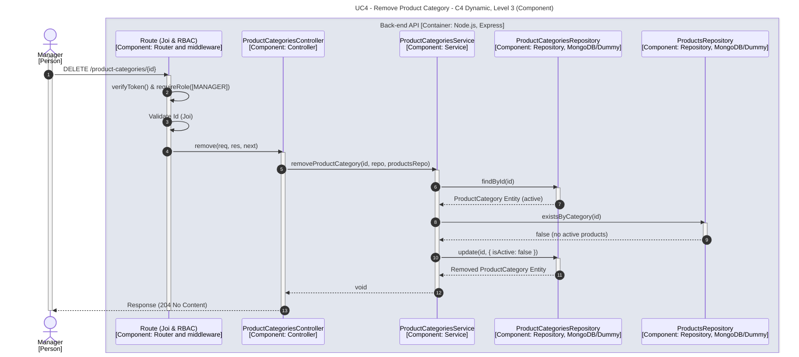

# UC4 - Remove Product Category

| Attribute | Value |
|---|---|
| C4 view | Dynamic diagram, Level 3 (Component) |
| SAD view | Process View, Level 3 |
| Container | Back-end API |
| Endpoint | `DELETE /product-categories/{id}` |
| Allowed roles | MANAGER |
| Success response | 204 No Content |
| Error handling | Happy path only |

## Description

A Manager removes a product category. The service checks that no active product uses the category and then deactivates it (logical removal by setting isActive to false).

## Diagram

See the [README](./README.md) for the notation key and the element catalogue.
