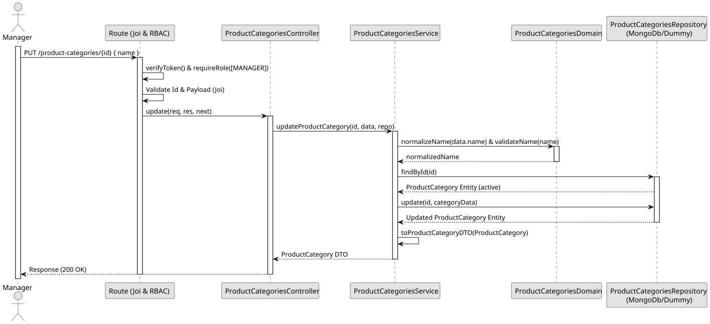

# UC3 - Update Product Category

## Use Case View

**Primary Actor:** Manager  
**Description:** Allows a manager to logically remove (deactivate) a product category.

**Preconditions:**

- The user must be authenticated and have the `Manager` role.
- The category must exist and currently be active.
- The category must not be referenced by any active product.

**Main Success Scenario:**

1. The Manager provides the ID of the category to remove.
2. The System validates the provided ID.
3. The System verifies the category exists and is currently active.
4. The System verifies that no active product references this category.
5. The System logically removes the category (sets it to inactive).
6. The System returns a 204 No Content response.

**Alternative Flows:**

- _Invalid ID provided:_ The System throws a 400 Bad Request error.
- _Category does not exist or is already inactive:_ The System throws a 404 Not Found error.
- _Category is referenced by an active product:_ The System throws a 409 Conflict error.

**Postconditions:**

- The category becomes logically inactive.

## 1. Domain Assumptions

- Only the name of a category can be changed;
- The new name follows the same rules as in the creation and cannot be used by another category;
- A removed category cannot be updated;
- Only users with the `Manager` role are authorized to update a product category.

## 2. Solution Design

## 3. Business Test Planning

- **Isolation Strategy:** All aplication tests use dependency injection via isolated in-memory dummies (`product-categories.dummy.repository.js`), avoiding Mocking libraries entirely.
- **Application Tests (`product-categories.service.test.js`):**
  - `updateProductCategory changes the name`
  - `updateProductCategory allows changing only the case of its own name`
  - `updateProductCategory rejects blank names`
  - `updateProductCategory returns 409 Conflict on duplicate name`
  - `updateProductCategory throws 404 if the category does not exist`
  - `updateProductCategory throws 409 if the category is inactive`

## 4. E2E Tests

- **Base Endpoint:** `PUT /api/v1/product-categories/{id}`
- **Validated Scenarios:**
  - Request without Bearer Token -> `401 Unauthorized`
  - Request with `EMPLOYEE` Bearer Token -> `403 Forbidden` (RBAC Enforcement)
  - Valid payload by `MANAGER` -> `200 OK`
  - Invalid id or blank name -> `400 Bad Request`
  - Unknown category -> `404 Not Found`
  - Duplicate category name -> `409 Conflict`
