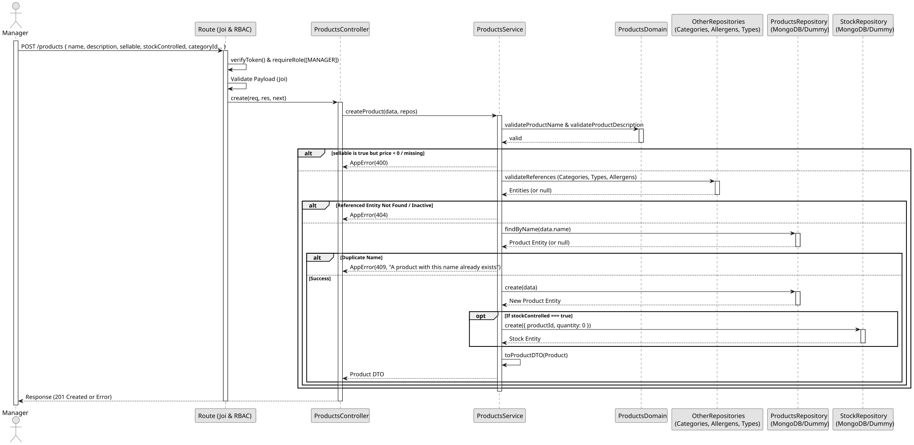

# UC1: Create Product

## Use Case View

**Primary Actor:** Manager  
**Description:** Allows a manager to create a new product in the system, optionally defining price, linking references (categories, allergens, component types), and initializing stock control.

**Preconditions:**

- The user must be authenticated and have the `MANAGER` role.

**Main Success Scenario:**

1. The Manager provides a valid payload for the new product.
2. The System validates that the name and description are not empty.
3. The System verifies that if the product is sellable, a valid price (>= 0) is defined.
4. The System verifies that any referenced category, component type, and allergens exist and are active.
5. The System verifies that the product name is unique.
6. The System creates and saves the new product.
7. If `stockControlled` is true, the System automatically creates a stock entry with `quantity: 0`.
8. The System returns the newly created product details with a 201 Created status.

**Alternative Flows:**

- _Missing mandatory fields, negative price, or sellable without price:_ The System throws a 400 Bad Request error.
- _Request by unauthorized user (No token or Employee):_ The System throws a 401 Unauthorized or 403 Forbidden error.
- _Referenced category, allergen, or component type not found/inactive:_ The System throws a 404 Not Found error.
- _Duplicate product name:_ The System throws a 409 Conflict error.

**Postconditions:**

- The new product is saved in the database.
- A stock entry is initialized if stock control is enabled.

## 1. Domain Assumptions

- Products must have a unique name.
- The name and description are mandatory and cannot be empty (enforced by domain validation).
- If a product is marked as `sellable: true`, it must have a valid `price` defined (greater than or equal to 0).
- A product can be linked to a Product Category, a Pizza Component Type, and multiple Allergens. All referenced entities must exist and be active.
- If a product is created with `stockControlled: true`, the system automatically initializes a Stock entry with `quantity: 0` for this product.
- Only users with the `MANAGER` role are authorized to create a new product.

## 2. Solution Design

## 3. Business Test Planning

- **Isolation Strategy:** All application tests use dependency injection via isolated in-memory Dummies (`products.dummy.repository.js`, `product-categories.dummy.repository.js`, `allergen.dummy.repository.js`, `pizza-component-type.dummy.repository.js`, and `stock.dummy.repository.js`), avoiding Mocking libraries entirely.
- **Domain Tests (`products.domain.test.js`):**
  - `validateProductName rejects non-string or empty values`
  - `validateProductDescription rejects non-string or empty values`
- **Application Tests (`products.service.test.js`):**
  - `createProduct enforces domain validations before saving`
  - `createProduct verifies if referenced category, component type, and allergens exist and are active`
  - `createProduct enforces price >= 0 if the product is sellable`
  - `createProduct automatically creates a stock entry if stockControlled is true`
  - `createProduct returns 409 Conflict on duplicate product name`

## 4. Postman E2E Tests

- **Base Endpoint:** `POST /api/v1/products`
- **Validated Scenarios:**
  - Request without Bearer Token -> `401 Unauthorized`
  - Request with `EMPLOYEE` Bearer Token -> `403 Forbidden` (RBAC enforcement)
  - Valid payload by `MANAGER` -> `201 Created`
  - Missing mandatory fields or negative price -> `400 Bad Request` (Joi validation)
  - Sellable product without price -> `400 Bad Request` (Business rule)
  - Referenced category/allergen/component type not found or inactive -> `404 Not Found`
  - Duplicate product name -> `409 Conflict`
