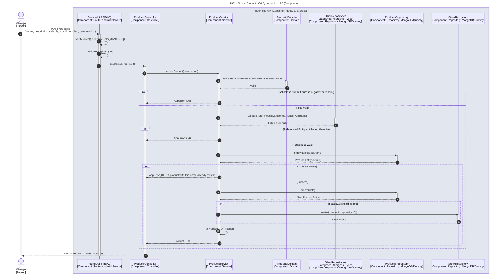

# UC1 - Create Product

| Attribute | Value |
|---|---|
| C4 view | Dynamic diagram, Level 3 (Component) |
| SAD view | Process View, Level 3 |
| Container | Back-end API |
| Endpoint | `POST /products` |
| Allowed roles | MANAGER |
| Success response | 201 Created |
| Error handling | 400 (sellable product without a valid price), 404 (referenced entity not found or inactive), 409 (product name already exists) |

## Description

A Manager creates a product. The domain validates the name and description, a sellable product needs a valid price, and the referenced categories, types and allergens must exist and be active. The name must be unique and, for stock-controlled products, an initial stock record with quantity 0 is created.

## Diagram

See the [README](./README.md) for the notation key and the element catalogue.
