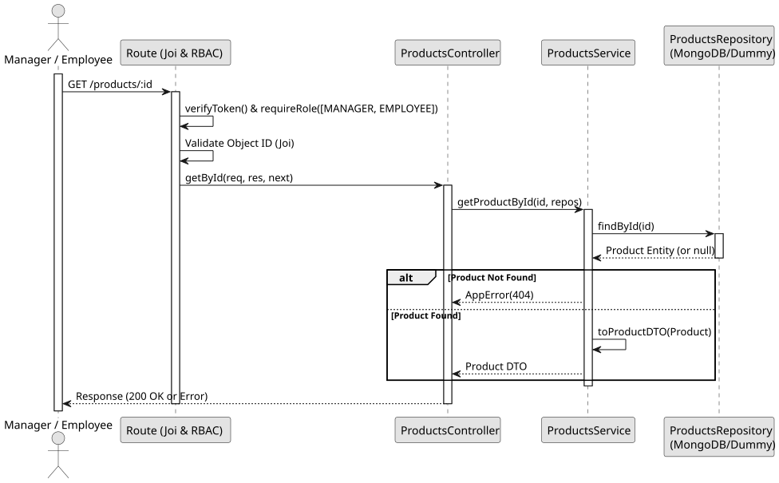

# UC3: Get Product by ID

## 1. Domain Assumptions

- Products can be queried individually by their unique ID.
- The ID must conform to the MongoDB ObjectId format.
- Users with both `MANAGER` and `EMPLOYEE` roles can view product details.

## 2. Solution Design

## 3. Business Test Planning

- **Isolation Strategy:** All application tests use dependency injection via isolated in-memory Dummies (`products.dummy.repository.js`), avoiding Mocking libraries entirely.
- **Application Tests (`products.service.test.js`):**
  - `getProductById returns correct product DTO`
  - `getProductById throws 404 AppError if product does not exist`

## 4. Postman E2E Tests

- **Base Endpoint:** `GET /api/v1/products/:id`
- **Validated Scenarios:**
  - Request without Bearer Token -> `401 Unauthorized`
  - Request with invalid ID format -> `400 Bad Request` (Joi CastError prevention)
  - Request with non-existent ID -> `404 Not Found`
  - Request with valid ID by `MANAGER` or `EMPLOYEE` -> `200 OK` (Returns product DTO)
