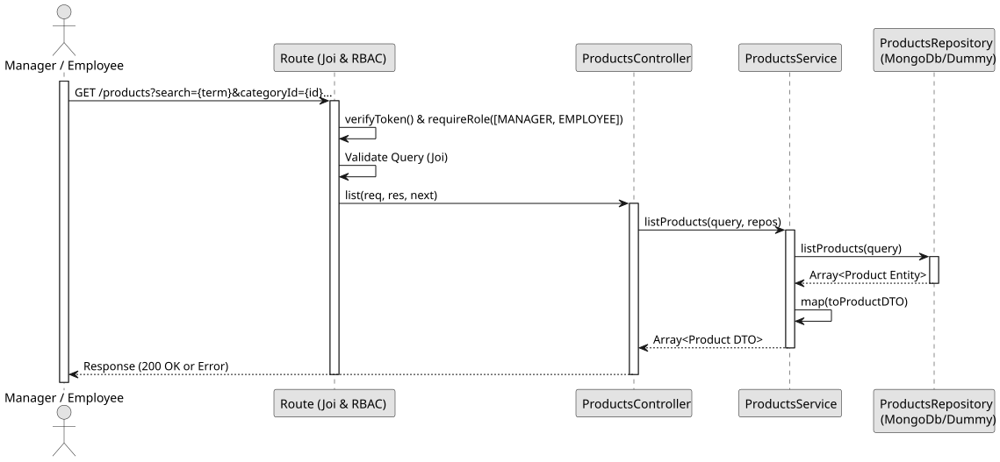

# UC2: List and Search Products

## Use Case View

**Primary Actor:** Manager / Employee  
**Description:** Allows an authenticated user to list all products or search and filter products based on a search term, category, sellable status, and active status.

**Preconditions:**

- The user must be authenticated and have the `MANAGER` or `EMPLOYEE` role.

**Main Success Scenario:**

1. The User requests the list of products, optionally providing query filters (search term, categoryId, sellable, isActive).
2. The System validates the query parameters.
3. The System queries the database for matching products, applying a case-insensitive partial match for the search term across names and descriptions.
4. The System maps the found entities to DTOs.
5. The System returns the list of products with a 200 OK status.

**Alternative Flows:**

- _No matching products found:_ The System returns an empty list `[]` with a 200 OK status.
- _Request by unauthorized user:_ The System throws a 401 Unauthorized error.

**Postconditions:**

- None (Read-only operation).

## 1. Domain Assumptions

- The system allows listing all products or filtering them based on multiple criteria: a search term, `categoryId`, `isActive`, and `sellable` status.
- The search term performs a case-insensitive partial match across the product's `name` and `description`.
- Users with both `MANAGER` and `EMPLOYEE` roles can view and search the product list.

## 2. Solution Design

## 3. Business Test Planning

- **Isolation Strategy:** All application tests use dependency injection via isolated in-memory Dummies (`products.dummy.repository.js`), avoiding Mocking libraries entirely.
- **Application Tests (`products.service.test.js`):**
  - `listProducts returns all products when no query is provided`
  - `listProducts filters products by search term (name/description), categoryId, sellable, and isActive`
  - `listProducts maps data to safe DTOs`

## 4. Postman E2E Tests

- **Base Endpoint:** `GET /api/v1/products`
- **Validated Scenarios:**
  - Request without Bearer Token -> `401 Unauthorized`
  - Valid request without filters by `MANAGER` or `EMPLOYEE` -> `200 OK` (Returns all products)
  - Valid request with matching `search` or `categoryId` filters -> `200 OK` (Returns matched products)
  - Valid request with non-matching filters -> `200 OK` (Returns `[]`)
