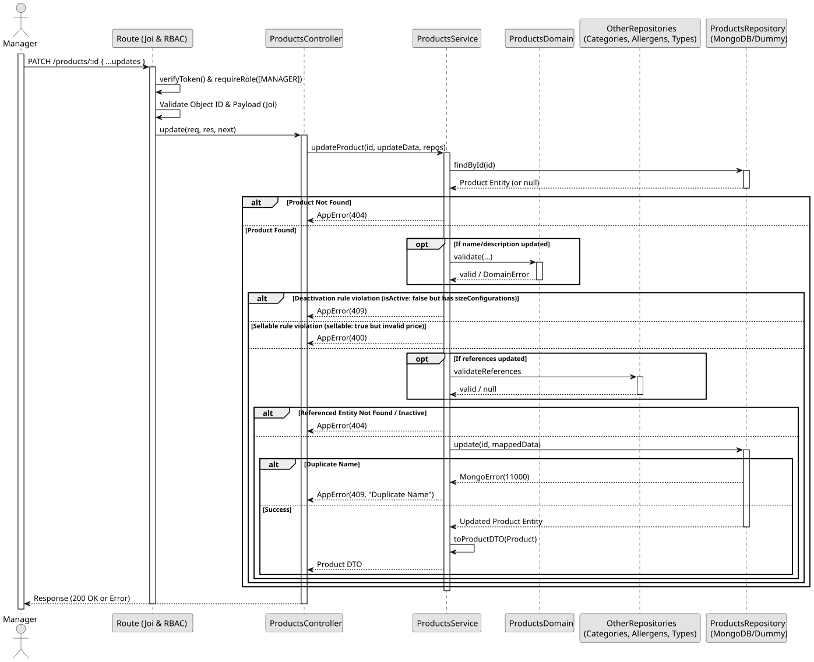

# UC4: Update Product

## 1. Domain Assumptions

- Products can have their details partially updated (name, description, price, sellable, stockControlled, references, etc.).
- Products can be logically deleted (deactivated) by setting `isActive: false`.
- **Crucial Rule:** A product cannot be deactivated (`isActive: false`) if it currently has active size configurations (`sizeConfigurations.length > 0`). These must be removed first.
- If a product is updated to `sellable: true`, it must have a valid `price` defined (>= 0).
- Updating the name requires the new name to be unique and domain-validated.
- Only users with the `MANAGER` role can update product details.

## 2. Solution Design

## 3. Business Test Planning

- **Isolation Strategy:** All application tests use dependency injection via isolated in-memory Dummies, avoiding Mocking libraries entirely.
- **Application Tests (`products.service.test.js`):**
  - `updateProduct applies partial changes and preserves existing data`
  - `updateProduct enforces domain validation on updated name and description`
  - `updateProduct refuses to set isActive to false if product has sizeConfigurations`
  - `updateProduct throws 400 if product is updated to sellable without a valid price`
  - `updateProduct verifies referenced entities (category, allergens, component type) exist and are active`
  - `updateProduct rejects a name used by another product (409 Conflict)`

## 4. Postman E2E Tests

- **Base Endpoint:** `PATCH /api/v1/products/:id`
- **Validated Scenarios:**
  - Request without Bearer Token -> `401 Unauthorized`
  - Request with `EMPLOYEE` Bearer Token -> `403 Forbidden` (RBAC enforcement)
  - Empty JSON payload -> `400 Bad Request` (Requires at least one field to update)
  - Invalid ID format -> `400 Bad Request`
  - Non-existent ID -> `404 Not Found`
  - Invalid referenced entity (category/allergen) -> `404 Not Found`
  - Deactivation (`isActive: false`) when having size configurations -> `409 Conflict`
  - Duplicate product name -> `409 Conflict`
  - Valid partial update or deactivation -> `200 OK`
