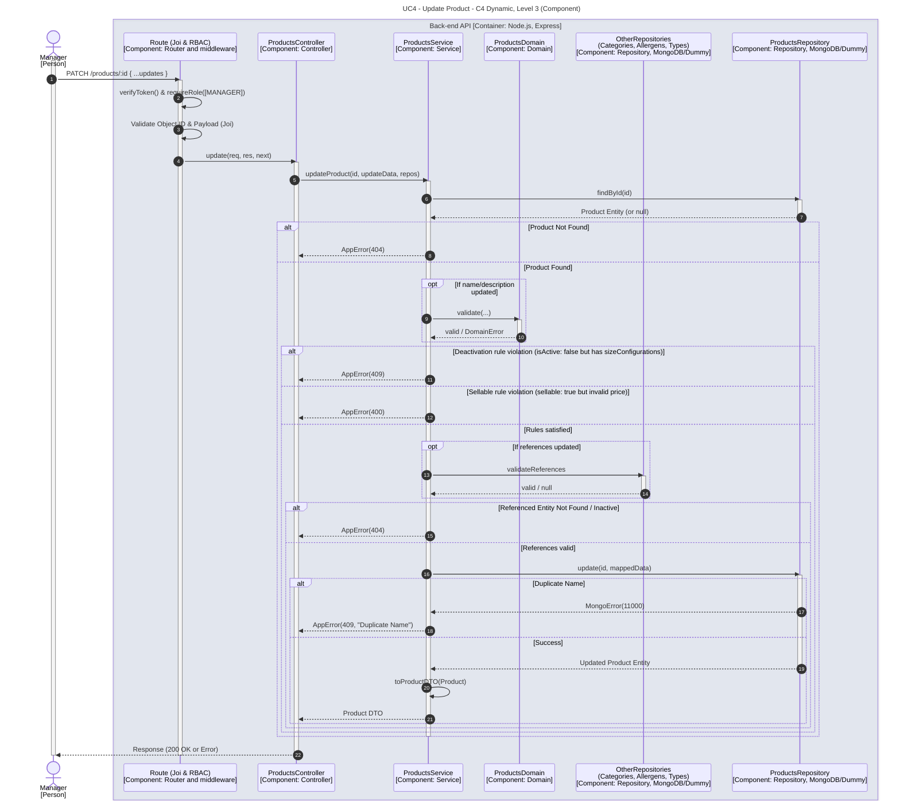

# UC4 - Update Product

| Attribute | Value |
|---|---|
| C4 view | Dynamic diagram, Level 3 (Component) |
| SAD view | Process View, Level 3 |
| Container | Back-end API |
| Endpoint | `PATCH /products/:id` |
| Allowed roles | MANAGER |
| Success response | 200 OK |
| Error handling | 404 (product or referenced entity not found or inactive), 409 (deactivation with size configurations, or duplicated name), 400 (sellable product with invalid price) |

## Description

A Manager partially updates a product. Name and description are re-validated by the domain, a product with size configurations cannot be deactivated, a sellable product needs a valid price, updated references must exist and be active, and a duplicated name results in a conflict error.

## Diagram

See the [README](./README.md) for the notation key and the element catalogue.
