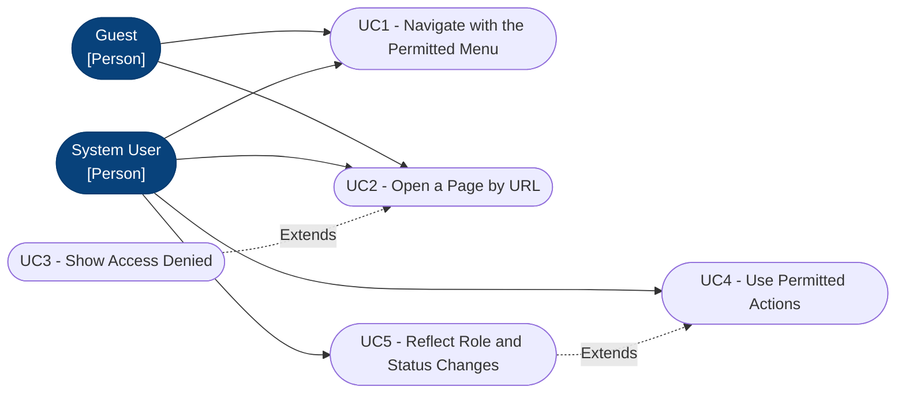

# Role-Based Navigation - Design Diagrams (Mermaid)

The Role-Based Navigation feature (WEB03) makes the Web Application show only the sections and actions the user may use. The menu, the route guard and the action buttons are all decided with the permissions returned by the back end (AA05): the permissions of the session (login, refresh, `GET /auth/me`) or, without a session, the Guest permissions (`GET /auth/guest-permissions`). The Web Application never compares role names nor keeps a copy of the permission matrix. Typing the URL of an unauthorized section shows a generic "access denied" page (or the login, for a Guest) and never loads its data; role and account changes are applied when the tab becomes visible again and after any `403`. Hiding is only a convenience: the back end checks every request ([AA05](../authorization/README.md)).

Process View (SAD), Level 3, documented as C4 dynamic diagrams of the **Back-end API** container. The **Web Application** appears as a single container: its internal work (menu, guard, pages) is shown as steps of that container and described in the text.

## Use Cases

The use cases are described in the [Use Case Views](../../analysis/use-case-views.md#web03-role-based-navigation).

## Diagrams

| Use case | Endpoint | Roles | Success | Document |
|---|---|---|---|---|
| [UC1 - Navigate with the Permitted Menu](./navigate-with-permitted-menu.md) | `POST /auth/refresh`, `GET /auth/guest-permissions` | Public (Guest), any authenticated user | Menu with the permitted sections | `navigate-with-permitted-menu.md` |
| [UC2 - Open a Page by URL](./open-page-by-url.md) | The API routes of the page (for example `GET /kitchen-configurations`) | As in the page registry below | The page and its data | `open-page-by-url.md` |
| UC3 - Show Access Denied | - (no request) | - | "Access denied" page at the same URL | shown in [UC2](./open-page-by-url.md) |
| [UC4 - Use Permitted Actions](./use-permitted-actions.md) | The API route of the action (for example `PATCH /stock/{productId}`) | As in the action's permission | The action's answer | `use-permitted-actions.md` |
| [UC5 - Reflect Role and Status Changes](./reflect-role-and-status-changes.md) | `GET /auth/me` | Any authenticated user | Menu, guards and buttons updated | `reflect-role-and-status-changes.md` |

## Page registry

Every page is an entry of `src/features/registry.js`. `requiresAuth` needs a session; `permission` needs that permission; a page with neither is public. The menu shows the entries that are not `showInNav: false`, whose session requirement is met and whose permission is granted (`visibleFeatures`). The permission of each page is the read permission of the API routes it uses (AA05).

| Page | Path | Session | Permission | In the menu | Who sees it (base roles) |
|---|---|---|---|---|---|
| Home | `/` | - | - | Yes | Everyone |
| Catalogue | `/catalogue` | - | - | Yes | Everyone |
| My data | `/my-data` | Yes | `customers:read:own` | Yes | Customer |
| Product categories, pizza sizes, pizza component types, products, predefined pizzas | `/product-categories`, `/pizza-sizes`, `/pizza-component-types`, `/products`, `/predefined-pizzas` | Yes | `products:read` | Yes | Employee, Manager |
| Allergens | `/allergens` | Yes | `allergens:read` | Yes | Manager |
| Stock | `/stock` | Yes | `stock:read` | Yes | Employee, Manager |
| Customers | `/customers` | Yes | `customers:read` | Yes | Manager |
| Kitchen configuration, 3D visualization | `/kitchen-configurations`, `/visualization3d` | Yes | `kitchen:read` | Yes | Manager |
| AI | `/ai` | Yes | `planning:execute` | Yes | Manager |
| Shared resources | `/shared-resources` | Yes | `resources:read` | Yes | Customer, Employee, Manager, Administrator |
| Users | `/users` | Yes | `users:read` | Yes | Administrator |
| Change password | `/change-password` | Yes | - | No (account menu) | Any authenticated user |
| Login, forgot password, reset password, account activation, external login callback | `/login`, `/forgot-password`, `/reset-password`, `/activate`, `/auth/callback` | - | - | No | Everyone |
| Not found | any other path | - | - | No | Everyone |

A user with several roles sees the union of the sections of their roles. The buttons and forms inside a page use the write permission of their API route (for example `stock:write`, `pizzas:write`, `kitchen:write`, `allergens:write`).

## Business rules shown in the diagrams

- **Permissions from the back end only.** `usePermissions` returns `user.permissions` of the session when authenticated, otherwise the Guest permissions; `useCan(permission)` answers whether one is granted ([ADR-0054](../../adr/0054-permission-driven-navigation-in-the-web-application.md)). Nothing read from the browser storage can grant access: the session status only changes with an answer of the back end (login, refresh).
- **Loaded before the first page.** At start the Web Application restores the session with the refresh cookie (`POST /auth/refresh`, [Session Handling](../authentication/session-handling.md)) and loads the Guest permissions. Until the session is known, protected routes show "Loading" (`wait`), so a typed URL is never decided too early.
- **Route guard.** `resolveGuard(status, { requiresAuth, allowed })`: `wait` while the session is unknown; `login` for a Guest on a page that needs a session or a permission the Guest does not have, keeping the requested page to return to after the login; `denied` for a session without the permission; `allow` otherwise. Only on `allow` is the page component loaded, so a refused page never sends its data requests.
- **Generic "access denied".** Shown at the requested URL, inside the normal layout: title, "You do not have permission to open this page" and a link to the home page. It never names the permission, the role or anything of the page. Unknown URLs show "Page not found".
- **Actions follow the same permissions.** Buttons and forms of an action are only rendered with `useCan` of its API permission. The back end checks the request anyway; a `403` reloads the user (UC5) and shows the translated error.
- **Changes reach an open tab.** When the tab becomes visible again and after any `403`, the Web Application reloads the user with `GET /auth/me` (one request at a time). The menu, the guards and the buttons update at once; if the open page is no longer allowed it becomes "access denied". A `401` ends the session (after one refresh attempt when the token only expired) and leads to the login.
- **Back end still decides.** Hiding a section or a button is complemented by the permission check of every API route (AA05). The Web Application only avoids showing what would be refused.

## Related ADRs

| ADR | Decision | Status |
|---|---|---|
| [ADR-0007](../../adr/0007-web-application-%28spa%29-technology-and-structure.md) | Web Application (SPA) technology and structure | Accepted |
| [ADR-0019](../../adr/0019-internationalization-of-the-web-application-%28english-and-portuguese%29.md) | Internationalization of the Web Application (English and Portuguese) | Accepted |
| [ADR-0036](../../adr/0036-frontend-end-to-end-%28e2e%29-testing-framework.md) | Frontend end-to-end (e2e) testing framework | Accepted |
| [ADR-0043](../../adr/0043-secure-session-handling-in-the-api-and-the-spa.md) | Secure session handling in the API and the SPA | Accepted |
| [ADR-0053](../../adr/0053-permission-based-authorization-matrix.md) | Permission-based authorization with a single role matrix | Accepted |
| [ADR-0054](../../adr/0054-permission-driven-navigation-in-the-web-application.md) | Permission-driven navigation in the Web Application | Accepted |

## Notation key

| Notation | Meaning |
|---|---|
| Actor (stick figure) | Person using the system, with the role shown in the label |
| Participant "Web Application" | Container (React, Vite), shown without its internal components |
| Shaded box "Back-end API" | System boundary of the container (Node.js, Express) that holds all the components |
| Participant label | `Name`, followed by `[Type: technology]` |
| Solid arrow | Call or request |
| Dashed arrow | Return value or response |
| Arrow to the same participant | Work done inside that participant |
| Number on an arrow | Order of the interaction (autonumber) |
| `alt` / `else` frame | Alternative flows, only one of them runs |
| `opt` frame | Optional flow |
| `Note` | Reference to another diagram or a remark |

## Element catalogue

| Element | Type | Technology | Responsibility | Used in |
|---|---|---|---|---|
| Guest | Person | - | Person without a session | [UC1](./navigate-with-permitted-menu.md), [UC2](./open-page-by-url.md) |
| System User | Person | - | Authenticated user with one or more roles | All diagrams |
| Web Application | Container | React, Vite | Restores the session, keeps the session and Guest permissions, builds the menu, guards the routes, renders only permitted actions and reloads the user on visibility and on `403` | All diagrams |
| Router | Component | Express router | Applies the guard of the route and calls the controller | All diagrams |
| Authorization middleware | Component | Express middleware (`authorization.middleware.js`) | `requirePermission`, `requireAuthenticated`: authenticates the request and checks the permission (`401`/`403`, recorded) | [UC2](./open-page-by-url.md), [UC4](./use-permitted-actions.md), [UC5](./reflect-role-and-status-changes.md) |
| AuthController | Component | Express controller | `refresh`, `me`, `guestPermissions` | [UC1](./navigate-with-permitted-menu.md), [UC5](./reflect-role-and-status-changes.md) |
| AuthService | Component | Node.js module | `refresh` (new access token and session user), `getCurrentUser` (session user DTO with roles and permissions) | [UC1](./navigate-with-permitted-menu.md), [UC5](./reflect-role-and-status-changes.md) |
| Permission matrix | Component | Node.js module, pure functions (`permissions.domain.js`) | `GUEST_PERMISSIONS`, `permissionsFor(roles)` | [UC1](./navigate-with-permitted-menu.md), [UC5](./reflect-role-and-status-changes.md) |
| UsersRepository | Component | Repository, MongoDB (`Users`) | `findById` (status and roles) | [UC5](./reflect-role-and-status-changes.md) |
| Controller of the route | Component | Express controller | Business answer of the page data or of the action | [UC2](./open-page-by-url.md), [UC4](./use-permitted-actions.md) |

## Notes

- The Web Application side is in `src/features/registry.js` (pages and their access rule), `src/features/navigation.js` (`visibleFeatures`), `src/shared/auth/guard.js` (`resolveGuard`), `src/shared/auth/require-auth.jsx` (route wrapper), `src/shared/auth/use-can.js` (`usePermissions`, `useCan`), `src/shared/auth/permissions.js`, `src/shared/auth/guest-permissions.js` (Guest store), `src/shared/auth/session-store.js` (`reloadUser`), `src/shared/api/index.js` (`onForbidden`, `onSessionExpired`), `src/shared/ui/access-denied.jsx`, `src/shared/ui/not-found.jsx` and `src/main.jsx` (start and `visibilitychange`).
- All texts are in English and Portuguese, in `message.js` (`access.deniedTitle`, `access.deniedMessage`, `access.notFoundTitle`, `access.notFoundMessage`, `access.goHome`) ([ADR-0019](../../adr/0019-internationalization-of-the-web-application-%28english-and-portuguese%29.md)).
- Tests:
  - Unit tests with `node:test`: `test/features/navigation.test.js` (menu of each base role, of users with several roles and without roles), `test/features/registry-permissions.test.js` (every page classified, permission equal to its API routes), `test/features/no-role-names.test.js` (no role names in the components), `test/features/route-protection.test.js`, `test/features/app-routes.test.js`, `test/shared/auth/guard.test.js`, `test/shared/auth/guard-permissions.test.js`, `test/shared/auth/permissions.test.js`, `test/shared/auth/guest-permissions.test.js`, `test/shared/auth/auth-api-permissions.test.js`, `test/shared/auth/session-store-user.test.js` (`reloadUser`).
  - End-to-end (Playwright, [ADR-0036](../../adr/0036-frontend-end-to-end-%28e2e%29-testing-framework.md)): `test/e2e/web03-role-navigation.spec.js` with a simulated back end: menu per persona (Guest, Customer, Employee, Manager, Manager + Employee, user without roles), typed URLs (`login`, `denied`, `allow`, and no data request when denied), return to the requested page after the login, generic access-denied page, not-found page, and a role removed while the page is open. `kitchen-configuration.spec.js` and `assembly-line-configuration.spec.js` check that an Employee gets "access denied".
