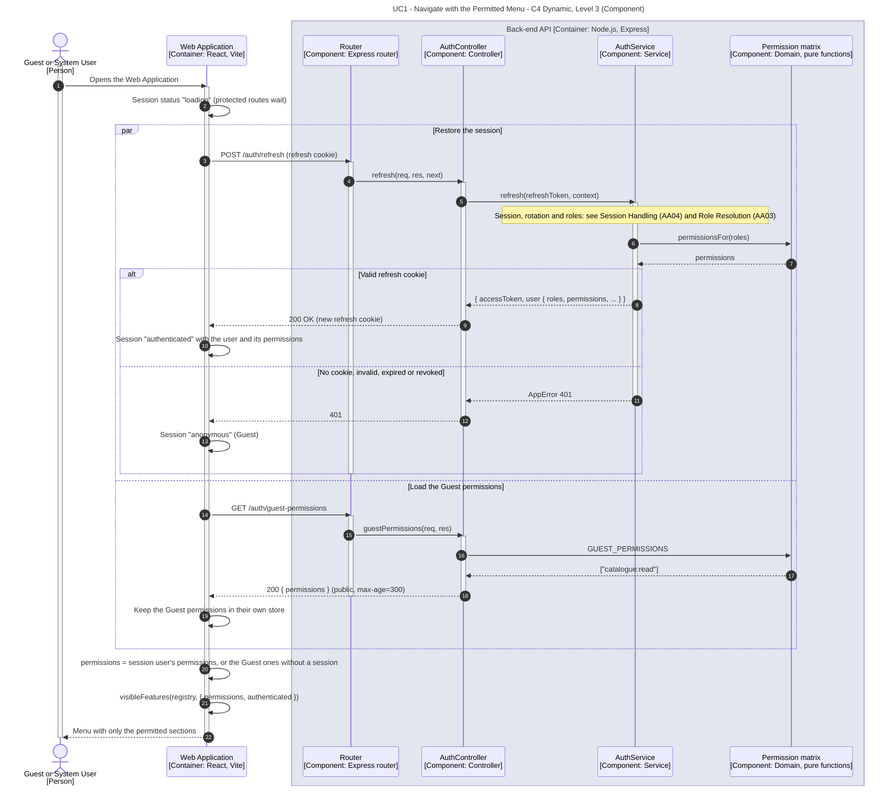

# UC1 - Navigate with the Permitted Menu

| Attribute | Value |
|---|---|
| C4 view | Dynamic diagram, Level 3 (Component) |
| SAD view | Process View, Level 3 |
| Containers | Web Application, Back-end API, Database |
| Endpoints | `POST /auth/refresh` (refresh cookie), `GET /auth/guest-permissions` |
| Allowed roles | Public (Guest) and any authenticated user |
| Success response | Session user `{ id, email, status, roles, permissions, customerId }` with a new access token, or `401` without a session; `{ "permissions": [...] }` for the Guest |
| Error handling | Refresh refused (no or invalid cookie): the visitor is a Guest. Guest permissions unavailable: an empty list, so only the public pages without a permission are shown |
| ADRs | [ADR-0043](../../adr/0043-secure-session-handling-in-the-api-and-the-spa.md), [ADR-0053](../../adr/0053-permission-based-authorization-matrix.md), [ADR-0054](../../adr/0054-permission-driven-navigation-in-the-web-application.md) |

## Description

Before the first page is shown, the Web Application learns what the visitor may use:

1. **Session.** It restores the session with the refresh cookie (`POST /auth/refresh`, detailed in [Session Handling (AA04)](../authentication/session-handling.md)). The answer carries the session user with the roles and the permissions computed by the back end from the roles in the database. A refused refresh means there is no session.
2. **Guest permissions.** It reads `GET /auth/guest-permissions` (public, no database access) and keeps them in a store of their own, separate from the session.
3. **Menu.** The layout takes the permissions of the session when authenticated, otherwise the Guest ones (`usePermissions`), and shows the registry entries that are in the navigation, whose session requirement is met and whose permission is granted (`visibleFeatures`). A user with several roles sees the union of their sections; a user without roles sees only what a Guest sees.

The menu is rebuilt whenever the session or its permissions change: after the login, after the logout, and when the user is reloaded ([UC5](./reflect-role-and-status-changes.md)).

## Diagram

See the [README](./README.md) for the notation key and the element catalogue.
