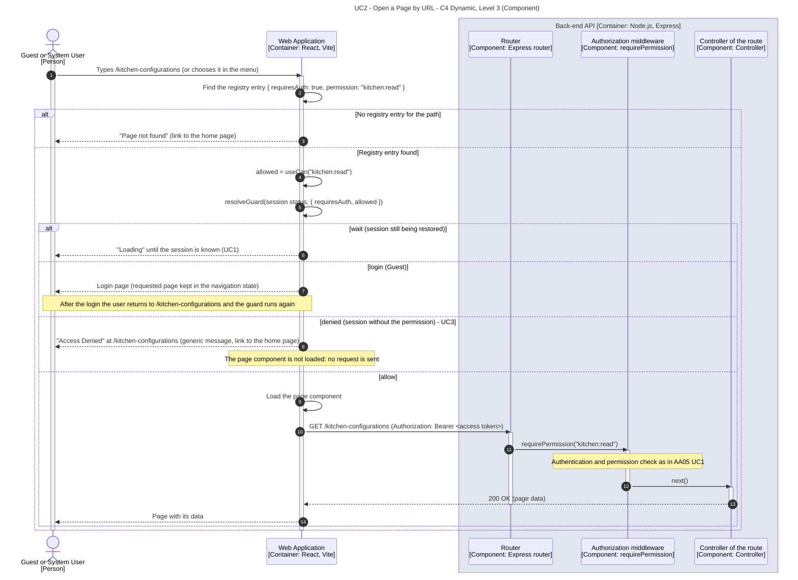

# UC2 - Open a Page by URL (and UC3 - Show Access Denied)

| Attribute | Value |
|---|---|
| C4 view | Dynamic diagram, Level 3 (Component) |
| SAD view | Process View, Level 3 |
| Containers | Web Application, Back-end API, Database |
| Endpoints | The API routes of the page, for example `GET /kitchen-configurations` (`kitchen:read`) |
| Allowed roles | Those with the permission of the page ([page registry](./README.md#page-registry)) |
| Success response | The page with its data |
| Error handling | Guest: login page, then back to the requested page. Session without the permission: "access denied" at the same URL (UC3), no data request. Unknown path: "page not found". The API answers `401`/`403` anyway if a request is sent (AA05) |
| ADRs | [ADR-0053](../../adr/0053-permission-based-authorization-matrix.md), [ADR-0054](../../adr/0054-permission-driven-navigation-in-the-web-application.md) |

## Description

Opening a section from the menu and typing its URL take the same path: every protected route of the registry is wrapped in a route guard that uses the access rule of the entry (`requiresAuth`, `permission`).

1. **Route.** The router finds the registry entry for the path. An unknown path shows "Page not found" inside the normal layout.
2. **Guard.** `resolveGuard(status, { requiresAuth, allowed })`, where `allowed` is `useCan(permission)` with the permissions of the session or the Guest ones:
   - `wait` while the session is being restored ([UC1](./navigate-with-permitted-menu.md)): "Loading", nothing is decided yet;
   - `login` for a Guest: the login page, keeping the requested page (path and query) to return to after the login;
   - `denied` for a session without the permission: **UC3**, the "access denied" page at the same URL;
   - `allow` otherwise.
3. **Page.** Only on `allow` is the page component loaded, so a refused page never sends its data requests. Its requests still go through the permission check of the API ([AA05 UC1](../authorization/access-protected-functionality.md)).

The "access denied" page is generic: the title "Access Denied", "You do not have permission to open this page" and a link to the home page. It never names the permission, the role or the content of the page, and the menu stays available.

## Diagram

See the [README](./README.md) for the notation key and the element catalogue.
