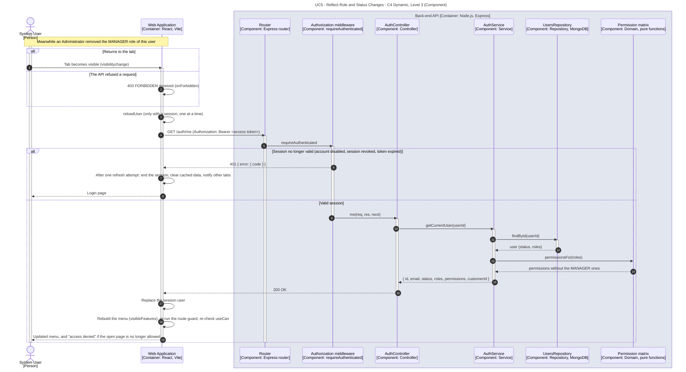

# UC5 - Reflect Role and Status Changes

| Attribute | Value |
|---|---|
| C4 view | Dynamic diagram, Level 3 (Component) |
| SAD view | Process View, Level 3 |
| Containers | Web Application, Back-end API, Database |
| Endpoint | `GET /auth/me` |
| Allowed roles | Any authenticated user (`requireAuthenticated`) |
| Success response | 200 OK `{ id, email, status, roles, permissions, customerId }`, `Cache-Control: no-store` |
| Error handling | `401` (account disabled or deleted, session revoked, token expired and refresh refused): the session ends and the user goes to the login. Network or `503` failure: the current user is kept until the next attempt |
| ADRs | [ADR-0032](../../adr/0032-secure-session-handling-in-the-api-and-the-spa.md), [ADR-0046](../../adr/0046-permission-based-authorization-matrix.md), [ADR-0047](../../adr/0047-permission-driven-navigation-in-the-web-application.md) |

## Description

An Administrator can add or remove a role, or disable an account, while the user has the Web Application open. The back end applies the change on the next request (AA05: roles are read from the database every time); the Web Application applies it as follows:

1. **When.** The Web Application reloads the user when the tab becomes visible again (`visibilitychange`) and after any `403` from the API (`onForbidden`). Only one reload runs at a time; without a session nothing is sent.
2. **Reload.** `GET /auth/me` returns the user with the roles and permissions read from the database ([AA05 UC2](../authorization/consult-session-permissions.md)).
3. **Apply.** The session user is replaced. The menu, the route guards and the action buttons depend on it, so they update at once: a removed section leaves the menu, an open page that is no longer allowed becomes "access denied" ([UC3](./open-page-by-url.md)), and a new section appears.
4. **Account or session ended.** A `401` from any request ends the session (after one refresh attempt when only the access token expired): the cached data is cleared, the other tabs are told, and the user goes to the login. A disabled account cannot refresh nor log in.

## Diagram

See the [README](./README.md) for the notation key and the element catalogue.
