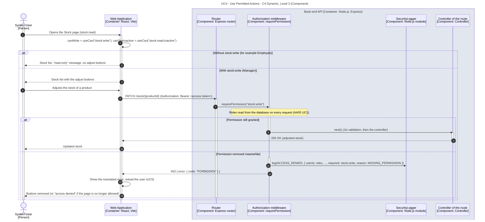

# UC4 - Use Permitted Actions

| Attribute | Value |
|---|---|
| C4 view | Dynamic diagram, Level 3 (Component) |
| SAD view | Process View, Level 3 |
| Containers | Web Application, Back-end API, Database |
| Endpoints | The API route of the action, for example `PATCH /stock/{productId}` (`stock:write`) |
| Allowed roles | Those with the write permission of the action (for example Manager for `stock:write`) |
| Success response | The answer of the action (for example 200 with the adjusted stock) |
| Error handling | Without the permission the action is not offered. If the request is sent anyway (permission removed meanwhile, or a crafted request), the API answers `403 FORBIDDEN` (recorded) and the Web Application reloads the user ([UC5](./reflect-role-and-status-changes.md)) |
| ADRs | [ADR-0046](../../adr/0046-permission-based-authorization-matrix.md), [ADR-0047](../../adr/0047-permission-driven-navigation-in-the-web-application.md) |

## Description

A page can be open to users with different permissions; for example, the Stock page is open to Employees and Managers (`stock:read`), but only Managers adjust stock (`stock:write`) or see inactive products (`stock:read:inactive`).

1. **Rendering.** The page asks `useCan` for the permission of each action's API route. Without it, the buttons and forms of that action are not rendered, and read-only pages say so ("read-only" message).
2. **Request.** With it, the action sends its request with the access token.
3. **Check in the back end.** The route checks the permission again ([AA05 UC1](../authorization/access-protected-functionality.md)). Hiding the button is never the only protection.
4. **Refusal.** A `403` (the permission was removed after the page was rendered) shows the translated error and reloads the user; the buttons disappear and, if the page itself is no longer allowed, it becomes "access denied" ([UC5](./reflect-role-and-status-changes.md)).

## Diagram

See the [README](./README.md) for the notation key and the element catalogue.
